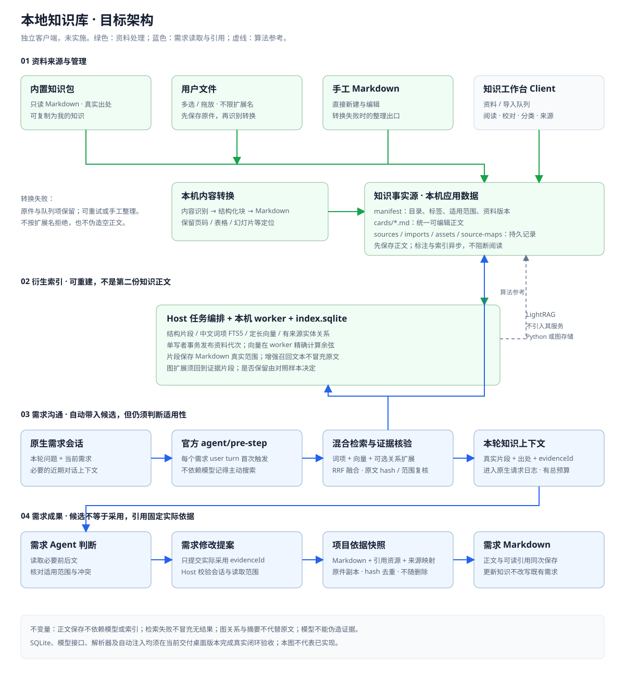

# 本地知识库与需求引用方案

状态：评审修订稿 · V0.3  
日期：2026-11-08  
范围：独立客户端中的知识导入、Markdown 管理、本机检索及需求知识引用。本文只约定目标方案，不代表实现、模型效果或桌面验收完成。

## 1. 本轮评审结论

产品目标不是“做一个能搜索的文档库”，而是：**用户进行需求沟通时，系统在每个新用户 turn 自动尝试检索，把经原文核验的相关候选带入本轮，让助手据此讨论或修改需求，并保留提案显式关联的依据。**“存在相关内容”是否被命中由冻结样本的召回／精度预算衡量，不作绝对召回承诺；所有被注入的候选都必须经过原文核验。

| 性质 | 本轮结论 |
| --- | --- |
| 已明确的产品边界 | 独立客户端，不新增产品后端、LightRAG 服务、远端知识空间或多租户登录体系 |
| 本次明确的导入约束 | 文件接收不设置扩展名白名单；成功导入的知识底层统一保存为 Markdown，界面以排版后的文档呈现和编辑；内置知识与用户知识都可浏览和管理 |
| 本次明确的使用目标 | 相关内容应在需求沟通过程中自动进入本轮上下文，不能只依赖模型记得调用搜索工具 |
| 本次明确的交互约束 | 不用三栏挤压明细；采用“资料列表 → 整页明细”；编辑所见即所得；业务界面不出现 Host、Markdown、索引、快照等需要特殊理解的技术名词 |
| 保留的有效设计 | 原文与衍生索引分离；先保存正文后处理；分类与适用范围分离；Host 核验实际读取内容；需求固定版本快照 |
| 替代原文件索引建议 | 使用一个嵌入式 SQLite 衍生索引库和本机 worker，不再设计 `catalog.json + chunks.json + vectors.f32 + graph.json` 的多文件发布协议 |
| LightRAG 的定位 | 参考结构切片、混合候选、有来源关系扩展及增量处理；不照搬其服务、存储抽象、实体合并或模型自报引用 |

需要特别区分两句话：

- **不限导入类型**是指任何扩展名都可接收、保存原件并进入识别流程；不等于任意二进制、加密或损坏文件都能被自动理解。无法自动转换时必须明确失败，并允许用户基于原件手工整理文档，底层仍保存为 Markdown。
- **自动带入知识**是指带入有出处的候选原文，不等于把候选自动确认为项目事实、自动写成需求或自动形成引用。

配套材料：

- [交互原型](interaction.html)：资料列表、整页明细、导入记录、所见即所得编辑和需求参考演示，可独立离线打开。
- [目标架构图](architecture.svg)：统一 Markdown、SQLite 衍生索引、自动需求上下文及固定引用的组件关系。
- HTML 中的资料、转换结果、匹配结果和引用均为虚构演示，不连接真实文件、模型或 SQLite，不证明实际效果。

## 2. 产品目标与边界

### 2.1 目标

1. 用户可以导入任意扩展名的本机文件，保留原件；转换成功后得到统一、可阅读、可编辑的文档正文，底层保存为 Markdown。
2. 用户可以按业务含义浏览内置知识和我的知识，维护目录、标签、适用范围，查看原件、出处、转换提示及处理异常。
3. 用户从列表进入整页明细，直接编辑排版后的文档；保存格式、技术处理和证据标识不要求用户理解。
4. 需求助手在每一轮新的需求问题中自动检索相关知识；返回真实命中片段而不是固定摘要或文档开头。
5. 助手结合当前需求、本轮问题及必要对话背景判断适用性，读取必要前后文，不把标题、标签、摘要或图关系当作业务事实。
6. 需求提案显式关联的依据绑定固定 Markdown 版本、真实范围和来源；知识更新或删除后仍可回读。
7. 原件保存、Markdown 保存、索引、检索和引用分别报告结果；模型、解析或索引失败不丢失已经保存的资料。
8. 沿用现有工作台、官方原生会话、工具接口及 Host 文件访问边界，不新增另一套聊天和项目管理体系。

### 2.2 明确不做

- 不部署知识后端、LightRAG HTTP 服务、数据库服务或向量数据库服务。嵌入式 SQLite 是本机库文件，不是独立服务。
- 不把 Python、LightRAG 运行时或本地模型权重作为本能力的新增随包依赖；解析优先使用受维护的 TypeScript／WASM 能力和已有模型配置。
- 不新增产品账号、多租户权限、组织共享或云端同步。
- 不以分类、校对、模型标注或索引完成作为阅读、编辑和需求工作的强制门禁。
- 不由知识自动确认业务规则、批准需求或覆盖用户决定。
- 不保留被替换的文件索引读写路径，不建立旧格式兼容层、migration、隐式 fallback 或多套可切换检索基础设施。
- 不把“独立客户端”等同于“所有模型离线运行”。资料和索引在本机，模型请求仍按客户端配置执行，可能访问外部供应商。
- 不把 SQLite 中的 chunk、摘要、实体描述或向量当作第二份权威正文；固定引用必须回到已保存 Markdown。

知识管理和需求会话应说明自动检索会使用哪些资料及模型供应商，沿用已有模型授权，不新增逐次确认。需求会话提供“自动参考知识”开关和本轮来源入口；关闭后仍可手工搜索和引用。不得因建立知识库而向独立知识服务上传全部本机资料。

### 2.3 本机用户边界

用户知识归当前操作系统账户的应用数据目录；内置知识随产品提供、只读。项目表示需求上下文与引用位置，不表示权限租户。

同一操作系统账户下不宣称存在不同产品用户的数据隔离；文件目录和 SQLite 都不是额外加密机制。Host 只在已授权本机资料范围内操作，导入文件中的脚本、宏、链接和指令均按数据处理，不执行。

## 3. 领域对象与统一 Markdown

| 概念 | 定义与职责 |
| --- | --- |
| 来源原件 `SourceAsset` | 用户导入文件的不可变字节、原文件名、内容 hash、实际识别类型、大小和导入时间；用于溯源与重新转换 |
| 知识资料 | 具有稳定 `documentId` 的逻辑资料；内置或用户来源不决定业务可信度 |
| 资料内容版本 | 一次已保存的 Markdown、元数据、资源及来源映射；以 `contentRevisionId` 识别，并记录 `bodyHash + metadataHash + assetsHash + sourceMapHash`；不被无关资料的全包版本变化阻断 |
| 索引代次 | 一个内容版本在指定切片、词项、抽取和 embedding 配置下形成的完整衍生结果，以独立 `indexGenerationId` 识别 |
| 来源映射 `SourceMap` | Markdown 范围到原 PDF 页码、Word 章节、PPT 幻灯片、Excel 工作表／单元格或图片区域的映射；只记录实际取得的位置 |
| 导入项 `ImportItem` | 一次文件接收及转换记录；关联原件、结果资料或失败原因，不是通用任务中心 |
| 知识目录 | 分类树与资料组织视图；移动目录不改变资料 ID、正文或来源 |
| 分类 | 少量、相对稳定的主题结构；一份资料有一个主分类 |
| 标签 | 模型提出、用户可纠正的多个检索线索；不替代正文 |
| 适用范围 | 资料明确适用的业务、组织、产品或期间；属于业务语义，不是分类或权限 |
| 知识片段 | 指定 Markdown 版本中的一个或多个真实 Unicode code-point 范围及章节路径，用于召回和证据读取 |
| 衍生索引 | 从资料版本生成的词项、向量、实体、关系及来源关联；可重建 |
| 本轮知识上下文 | Host 在每个需求 user turn 首次模型请求前自动加入的候选原文、出处、适用范围、转换提示和 `evidenceId`；不是采用记录 |
| 知识引用 | 需求提案显式申报、Host 可校验且用户可审阅的资料版本、原文范围、来源及应用说明；不等于搜索命中、模型因果使用证明或业务确认 |

### 3.1 Markdown 是知识正文，原件是溯源资产

- 每份成功导入或手工新建的资料都有真实 `.md` 文件；界面默认展示排版后的文档，而不是把抽取文本只放在数据库里。
- Markdown 只是存储和交换格式，不是用户操作概念。界面使用“文档／正文／编辑文档”，不提供源码与预览双栏；用户直接编辑标题、段落、列表和表格的渲染结果，保存后与阅读视图一致。
- 原始文件随用户资料保存在本机。用户校对或编辑文档不修改原件；重新转换形成候选新版本，并以差异避免静默覆盖人工修订。
- 简单表格使用 Markdown 表格；合并单元格等复杂结构可使用 Markdown 内的 HTML 表格。图片使用相对资源引用，公式使用明确的 Markdown/LaTeX 表达。正文文件与引用资源共同构成可读版本。
- 自动摘要、标签、图像描述和实体关系是辅助信息。模型生成的图像描述可进入召回副本，但必须标为生成信息，不能冒充原文或单独成为需求证据。
- 内置整理卡没有随包原件时，只保存整理正文和真实外部出处，不虚构原始文件、页码或“原文”身份。

### 3.2 来源坐标与人工修订

本文“知识原文／原文范围”指当前 canonical Markdown 的真实正文范围；只有在随包原件或外部出处明确支持时，才称其为来源文献原句。内置整理卡的整理正文不等于外部来源全文。

索引和引用使用未规范化 Markdown 的 Unicode code-point 范围，与现有 `Array.from` 分页语义一致。NFKC、小写、预分词及 token offset 只用于检索副本，不能改变正文坐标。

章节路径、重复表头和相邻段落可作为召回增强或阅读上下文，但每个增强部分都要映射到真实范围。对一个组合片段保存 `bodyRange + contextRanges`，而不是把拼接文本伪装成一个连续原文范围。人工改写的范围标记为“人工修订”，不得继续展示转换前的精确页码映射。

## 4. 导入与知识管理

### 4.1 业务界面与阅读路径

知识工作台只保留“资料”和“导入记录”两个业务视图，采用两级阅读而不是三栏并排：

1. **资料列表**：顶部为“导入文件”和“新建文档”。目录与来源用于筛选，列表展示标题、内容摘录、标签及必要提示；此页不展示明细第三栏。
2. **整页明细**：点击资料标题后进入独立整页，提供明确“返回资料列表”。正文占据主要阅读宽度，操作只有编辑、复制、参与需求沟通、删除等实际可用动作；“来源与原件”展示原文件、出处和原文件位置。
3. **导入记录**：显示本批及历史未完成项，固定区分“已接收、正在转换、已加入资料、需要处理”。已接收不等于已自动转换，自动转换和手工整理都可加入资料。只有取得真实页数等数据时才显示确定进度，不生成伪百分比。

窄窗口同样先列表、后整页明细，不并列挤压内容。导入失败固定在对应记录中，不用短暂提示代替可恢复入口。

业务界面不得出现 Host、Markdown、OCR、索引、检索、快照、evidenceId、hash、generation 等技术术语。技术实现和诊断仍可存在于设计文档及专门诊断入口，但普通用户操作不依赖这些概念。

| 技术概念 | 用户可见表达 |
| --- | --- |
| Markdown | 文档、正文、编辑文档 |
| 导入队列 | 导入记录 |
| OCR | 识别图片文字 |
| 索引／检索 | 整理／查找／搜索 |
| 本轮知识候选 | 本次参考 |
| 需求关联依据 | 需求依据 |
| 固定快照 | 当时内容、引用时保存的内容 |
| evidenceId、hash、模型签名 | 不在业务界面显示 |

处理提示必须说明用户能做什么，例如“正在整理，仍可正常阅读和编辑”，而不是展示技术阶段。查找能力尚未准备好时使用“部分资料可能暂时找不到”，并提供重试；不能让用户先理解词项、向量或发布状态。

### 4.2 任意类型接收与转换流程

1. 文件多选或拖放后，Host 立即按内容 hash 保存原件和导入项，再开始耗时处理。资源大小、批量数量和超时仍须有限制，但命中限制要如实说明，不能按扩展名直接拒绝。
2. 综合文件签名、容器结构、MIME、文本编码和扩展名识别实际内容；扩展名只是线索，识别错误允许用户纠正。
3. 解析器输出统一的内部结构块：类型、正文、标题路径、来源定位和资源引用；再由同一个 Markdown 渲染器生成正文。模型不得自由拼出未经校验的整份知识文件。
4. Markdown／文本保留结构和原始内容；Office／PDF 提取标题、段落、列表和表格；扫描件／图片只有在已验证 OCR／视觉能力可用时自动提取。不得因安装了文本生成模型就宣称支持所有格式。
5. 转换后校验可自动验证的非空正文、块顺序、表格结构和来源映射不变量；这只证明内部结构一致，不证明已发现所有 OCR 或版面错误。已识别的缺字、页面缺失、阅读顺序不确定等警告持续显示，并随检索证据返回；保真仍需第 13 节的人工抽样验收。
6. 未识别、加密、损坏、无文本或缺少可用解析能力时，保留原件并显示“需要处理”，提供重试、查看原件和手工整理文档。不得发布空正文或把失败显示为导入成功。手工整理保存后关联原 `importId` 与原件，导入项转为“已加入资料（手工整理）”，原转换失败信息保留在诊断中。

校对是可随时使用的编辑能力，不新增“校对完成／批准入库”状态。人工校对也不证明业务内容正确。OCR 或模型处理涉及外部供应商时沿用统一授权与说明，不逐文件增加确认，也不得静默使用未授权通道。

### 4.3 保存、标注与索引分离

用户保存文档 → Host 校验及条件写入 canonical Markdown → 返回实际资料版本 → 持久化后续处理 → 模型标注／关系抽取／向量编码 → 发布该版本索引。

保存成功后，即使模型未配置、超时或结果不合法，资料仍可阅读和编辑。AI 修改知识正文仍走提案审阅；后台处理只能更新辅助元数据与索引，不能改写正文、原件或来源事实。

`ImportItem` 及转换失败原因使用独立原子文件持久化，不只存在可重建 SQLite 中。接收时先保存原件，再保存导入项；启动时核对已保存原件与导入项，不能把中断造成的未登记原件静默删除。

资料保存先把 Markdown、来源映射和资源以不可变内容写入临时位置并原子改名，最后条件提交 manifest；manifest 提交才是资料可见点。中断留下的新文件不进入目录，旧 manifest 仍指向完整旧版本；启动按引用关系核对孤儿或缺失文件。不得宣称这些文件与 manifest 存在跨文件原子事务。

用户资料更新以 `documentId + 当前 contentRevisionId` 做条件写入；目录树操作使用自己的清单版本。不能用全局用户包版本让一份资料的编辑、导入或删除被另一份无关资料阻断。

### 4.4 内置知识与用户知识

- 内置知识只读，可阅读、检索、引用和“复制为我的知识”；用户副本保留来源关系，产品升级不得静默覆盖副本。
- 内置包随产品原子更新，显示包版本和来源说明。内置条目升级或下架不影响既有需求快照。
- 内置和用户资料均可设置“在需求沟通中自动参考”。该偏好保存在当前 OS 账户的用户 manifest 中，以 `packId + documentId` 关联，不修改随包内置文件；升级后按稳定 ID 延续，条目下架后可清理无用偏好。它不是审批或权限状态，只影响后续检索，不修改既有引用。
- 用户纠正的分类和标签与模型结果分来源保存；后续标注不得覆盖人工修正，模型不得自动创建大量相近分类。

### 4.5 重复、更新和删除

- 原件 hash 相同：直接定位已有资料或导入项，不重复转换；用户仍可打开现有资料。
- 同一来源位置内容变化：提供“更新已有资料／作为新资料”；更新保留 `documentId` 并生成新 Markdown 版本，先展示差异，不按文件名自动覆盖。
- 不同原件得到相同 Markdown：提示可能重复但允许保留，因为不同出处有独立业务意义；相似内容不自动合并。
- 批量导入按文件独立成功或失败，不做整批回滚；可重试失败项、取消未完成项、清除已完成队列记录。清除队列记录不删除资料或原件。
- 删除资料会移除目录入口、后续检索准入及衍生索引；已有需求和活动提案的项目快照保留。引用存在不是禁止删除的门禁。
- 删除需求引用只影响当前需求；不得反向删除知识资料。快照只有在证明无需求或活动提案使用后才可清理。

## 5. 需求沟通如何自动使用知识

### 5.1 Host 自动带入，而非提示词碰运气

固定宿主公开了 `agent/pre-step` waterfall：`next()` 返回 `PreStepDecision`，调用方可替换其中的 `messages`，实际循环再提交这些消息。本方案把它作为目标集成点，不新增上游补丁，也不把系统提示词当作检索已经发生的证据。实施先以真实插件最小 spike 验证需求会话识别、Shell 上下文取得、追加时机、会话日志、取消和失败传播；未完成该验证前不宣称自动注入已经可交付，接口不足则登记 blocked-upstream。

触发与注入流程：

1. 处理需求助手会话中每个新 user turn 的首次 `pre-step`，并要求“自动参考知识”已开启；按 turn／请求标识去重，同一 turn 的工具续步不重复检索。先调用 `next()` 保留其他中间件决定和原始消息。
2. Host 以本轮问题为独立查询，并结合当前需求与必要的近期对话形成另一个上下文查询。原始问题始终保留，不能被模型改写替换；长需求按当前编辑章节或有界结构段查询，不静默截断后假装覆盖全文。
3. 执行词项、向量和可用的有来源关系召回，融合候选。用户明确指定的来源／分类是硬过滤；模型猜测的适用范围不是硬过滤。
4. 对准备注入的每个片段回到 canonical Markdown 核对 `bodyHash`、范围和内容，读取必要上下文，登记会话／项目绑定的 `evidenceId`。
5. 追加一条有明确数据边界的知识上下文消息：真实片段、标题、出处、适用范围、来源定位、转换提示、命中原因和 `evidenceId`。该消息进入原生请求与会话日志，知识内容不能授予指令或写权限。
6. 助手把候选作为参考继续本轮需求工作；可调用搜索和读取工具补充查询。自动注入不产生需求采用记录，也不要求助手使用所有候选。

检索成功但没有候选时，可明确告知“本轮未检索到相关知识”；检索失败、超时、embedding 缺失或索引不完整时必须说明未完成的能力，不能伪装成空结果。失败不丢弃原始需求输入，也不把知识缺失变成业务门禁。

需求界面使用“本次参考”和“需求依据”两个独立区域。本次参考可以忽略；需求依据表示提案显式关联且 Host 可核验的证据，不宣称技术机制能证明模型因果使用。

### 5.2 从候选到需求采用

1. 助手先阅读自动带入的片段；上下文不足时，通过 `read` 取得同章节、前后段、完整表格或其他必要范围。
2. 判断资料是否适用于本项目，是否与其他依据、用户决定或更新版本冲突。不能判断时提出具体澄清问题，不默认选择最新、内置、图度数最高或检索第一的资料。
3. 形成需求修改提案时，只提交需要关联证据的 `evidenceId`、采用范围及应用说明。没有使用就不附引用，不为显得“有依据”而堆砌来源。
4. Host 要求采用范围包含在该会话实际取得的原文范围内，从 canonical Markdown 生成可信引用和固定快照。模型自报正文、hash、出处或页码均不可信。
5. 用户在现有审阅流程检查需求正文、应用说明及依据；应用后正文与引用作为同一次成果保存。应用仍不表示业务需求已经确认。

用户也可从资料页或本次参考中选择“作为需求依据”；Host 必须实际读取并生成证据，再走同一需求提案／保存流程，不维护另一份与需求正文脱节的内存列表。

需求正文或项目上下文变化后，在下一用户 turn 使用新内容重新检索；后台保存本身不主动发起一次额外模型对话。不能复用按需求标题建立的永久候选。没有相关知识时继续基于已有业务证据工作，不编造依据。

### 5.3 可信证据与固定快照

`evidenceId` 由 Host 生成且不可猜测，绑定会话、项目、完整资料内容版本、实际返回的多个 Unicode 范围及各自 hash。自动注入和显式 `read` 共用同一证据登记器；分页或多次读取可以合并覆盖范围。标识仅在本次运行且所属会话／项目有效时可用，重启或失效后须重新读取。

chunk、evidence 和引用携带 `sourceText／OCR／manualEdit／generated` 等来源类型及转换警告。Host 不为 generated-only 内容签发证据标识；OCR 和人工正文可作为 canonical 知识正文引用，但必须保留其性质和警告，不能标成原文件逐字内容。

提案生成时即绑定 Host 固定的快照，不能在应用时再依赖可能已清理的内存记录。该机制只证明原文确实由 Host 返回并被提案显式关联，不证明模型因果使用、理解正确或业务结论正确。

需求 Markdown 继续作为唯一成果文件，记录可读依据说明和引用元数据。项目内 `.eadp/knowledge-sources/` 保存：

- 被关联版本的完整 Markdown、正文及来源元数据、实际范围和转换警告；
- Markdown 所引用图片等资源的不可变副本及 hash，保证固定版本不是缺少图片的孤立文本；
- 能取得时的来源映射和原件内容寻址副本；只有原件与对应映射均已固定且校验通过时，才提供原页／表格／幻灯片核对；
- 内置整理卡没有原件时，仅保存整理正文和真实出处，不伪造原始资产。

完整 Markdown、原件和资源等不可变字节按各自内容 hash 去重；快照身份不能只使用正文 hash。Host 另按规范化的“格式版本＋来源包＋documentId＋完整内容版本＋来源元数据／映射＋提案关联范围”计算 `snapshotId`，避免同正文、不同出处的资料被合并。快照 manifest 绑定上述全部组成部分。

固定 Markdown 和实际范围必须可回读；原始位置核对只在其前置资产完整时可用，界面分别显示，不统一宣称“完整溯源”。项目快照是需求交接的必要资产，不是可随时清理的检索缓存。未来传递项目时须包含该目录；只传需求 Markdown 不代表完整传递固定依据。

快照固定前，提案仍依赖运行时证据，不宣称重启可恢复。快照固定后，需求 Host 将提案及 `snapshotId` 持久化到项目 `.eadp/proposals/`，之后重启审阅不再依赖 `evidenceId`。快照写失败时可保留当前运行中的提案和输入供重试；只有持久化成功才宣称可跨重启恢复。未引用快照由启动核对需求及活动提案后再清理，不在异常时猜删。

### 5.4 保存与变化语义

- 快照写入失败：不写需求，保留当前运行中的提案和输入供重试；跨重启恢复以第 5.3 节持久化结果为准。
- 需求条件写入失败：原需求与原引用不变，新快照暂时可能未被引用，不误报成功；重试按内容去重。
- 知识更新：生成新正文身份与索引；已有引用继续读项目快照，只提醒存在新版本。
- 待审提案的来源更新或删除：固定快照完整则继续审阅原依据并提醒变化；尚未固定、范围越界或快照校验失败时必须重读。
- 内置升级、用户删除和原件清理均不得删除仍被需求使用的快照。

## 6. 纯客户端架构与职责



图中通信使用官方 Client／Host、工具及 `agent/pre-step` 机制，不表示远程服务。只使用公开 slot、service、tool 和模型接口；接口不足时登记缺口，不修改上游缓存或假定内部 API。

| 模块 | 职责与落点 |
| --- | --- |
| 知识 Client | `packages/eadp-knowledge/src/client/`；资料列表、整页明细、导入记录、来源、处理提示和重试；采用支持 canonical Markdown 双向转换的成熟富文本编辑组件，不把原型的简单可编辑区域当正式实现；不直接读取文件或调用 Node |
| 导入与转换 | Host 内聚模块；接收原件、识别内容、产出结构块和来源映射；共用 Markdown 渲染器，不执行导入内容；耗时解析进入受控 worker，不占 Client 或 Host 事件循环 |
| 原文存储 | 沿用 `src/host/store.ts` 的原子提交与 hash 思想，扩展原件、资源、来源映射、独立分类及资料级条件写入 |
| 索引任务 | Host 负责持久编排和模型 I/O；专用 worker 持有 SQLite、执行同步 SQL、切片和向量计算 |
| 检索模块 | 组装词项、精确词、向量与可选关系候选，执行 RRF、去重和预算；返回实际命中位置，不替模型作业务裁决 |
| 需求上下文安装器 | 知识 Host 在需求会话 `agent/pre-step` 自动检索；Shell 提供当前项目和需求上下文；原始消息及官方中间件决定不被覆盖 |
| 证据登记器 | 自动注入与读取工具共用；绑定会话／项目、资料版本和真实范围，供需求提案核验 |
| Agent 工具 | 按职责拆分现有 `src/host/proposals.ts`；提供目录、搜索、正文读取和知识提案，不暴露任意写索引或文件接口 |
| 共享契约 | `packages/eadp-contracts/src/knowledge.ts` 与 `requirements.ts`；导入、资料版本、检索命中、证据和固定引用 |
| 需求 Host／Client | `packages/eadp-requirements/`；证据核验、项目快照、固定后提案持久化、正文与引用同次保存及审阅显示 |
| Shell 会话策略 | `packages/eadp-shell/src/host/session-policy.ts`；保留工具使用与知识数据边界提示，不再把提示词当作自动检索机制 |

按职责拆分转换、存储、任务、检索、证据和工具；只抽取已有多个入口共用的代码。不增加通用 RAG 服务注册器、四套 LightRAG 查询模式或可插拔存储矩阵。

## 7. SQLite 存储与一致性

### 7.1 保存位置与事实源

```text
<应用数据>/knowledge/
  manifest.json                       # 权威目录、资料元数据及人工修正
  cards/<id>.<bodyHash>.md             # 权威 Markdown 正文
  sources/<sourceHash>/payload         # 不可变原件，文件名在元数据中
  sources/<sourceHash>/metadata.json
  imports/<importId>.json              # 权威导入项、转换结果或失败原因
  assets/<documentId>/...              # Markdown 引用的图片等资源
  source-maps/<contentRevisionId>.json # Markdown 到原件的真实定位
  index/index.sqlite                   # 可重建索引及索引任务
```

Manifest 与正文文件是知识事实源；原件、来源映射、资源和导入项是各自的持久事实或操作记录。SQLite 中的目录副本、chunk 文本、预分词文本、向量、图和索引任务都是衍生视图，可重建。未提交草稿与项目引用快照不是缓存。索引损坏可在明确诊断后重建，但不能因暂时 I/O 错误就猜删数据库。

本轮本机 Node 22.22.0 实测为 SQLite 3.50.4、启用 FTS5；`node:sqlite` 仍为实验 API 且 `DatabaseSync` 同步执行。因此数据库连接、SQL 和向量扫描归专用 worker，Host 不直接做阻塞计算。该实测不等于当前交付桌面已经验证，发行验收须重新核对实际运行时和 FTS 行为。

### 7.2 最小表职责

| 表 | 关键职责 |
| --- | --- |
| `index_generations` | `indexGenerationId + contentRevisionId + packId + documentId + bodyHash + metadataHash + assetsHash + sourceMapHash + processingSignature`；唯一识别一次完整索引结果 |
| `documents` | 当前已发布 `currentGenerationId` 指针；唯一定位词项、向量和图的同一代次，不能直接读取未提交代次 |
| `chunks` | `indexGenerationId + 稳定 chunkKey`、序号、主正文范围、上下文范围、章节路径、原始内容及 hash；rowid 不作公开引用 |
| `chunks_fts` | 标题、标签、章节和正文预分词后的检索副本；与 chunk 同事务维护 |
| `chunk_embeddings` | `chunkId + embeddingSignature + dimensions + Float32 BLOB`；禁止使用 JSON 数字数组 |
| `entities / edges` | index generation 作用域内的实体和关系，保留别名／关系关键词及内容版本；关系度数或 weight 不是业务置信度 |
| `graph_fts` | 实体名、别名、描述、关系端点和关系关键词的词项检索副本；只用于找到图种子 |
| `mentions` | 实体或关系到 chunk／真实范围的多对多证据；不用分隔符拼接来源，也不在存储层截断来源清单 |
| `jobs` | Markdown 保存后的标注／索引输入、阶段和失败；启动时可由事实源核对补建，不承担原件转换队列的权威记录 |

实体和关系首期保持 index generation 作用域，同名实体只形成跨资料候选，不设全局名称唯一键。跨资料等价关系必须另有证据，不能只凭同名、实体类型多数票或模型摘要物理合并。

### 7.3 代次发布与查询快照

1. 模型、embedding 和全部输入准备始终在 SQLite 事务外完成；未提交 generation 不可查询。
2. 发布前由 Host 对同一资料取得变更 fence，核对 manifest 中资料存在及 `contentRevisionId／bodyHash／metadataHash／assetsHash／sourceMapHash`，并将任务处理签名与当前生效的切片、词项、抽取和 embedding 配置核对。worker 再用一个 `BEGIN IMMEDIATE` 写入 generation、chunks、FTS、向量、图及 `documents.currentGenerationId`；COMMIT 是唯一发布点，事务中不做网络请求。
3. 发布失败或 COMMIT 前中断会整体回滚，旧 generation 仍可查；COMMIT 后、任务回执前中断由启动读取当前指针和 jobs 核对，不重复发布。迟到任务不得发布到新内容版本，处理配置变化也不得发布旧算法结果。
4. 正文保存不等待 SQLite，也不存在正文文件与 SQLite 的跨存储原子事务。保存到任务登记之间中断时，启动 reconciliation 根据事实源补齐处理。
5. 查询开始先按权威 manifest 计算资料存在、参与自动检索及用户明确过滤的准入集合，再在短读事务中固定当前 generation 集合，完成词项、向量和图候选读取后释放；不能把读事务保持到模型生成结束。
6. 返回前再按 manifest 核验候选的完整内容版本和最新检索偏好；已删除、正文／资源／映射或本次过滤相关元数据变化的候选排除并报告索引滞后，最新偏好为关闭的候选直接排除。检索偏好不写入 generation、不触发重建。`read` 和自动注入仍独立重读 Markdown 核验。
7. 单连接串行读写时无需为“并发”引入复杂协议；确需独立读写连接时再采用 WAL，并避免长读阻碍 checkpoint。数据库主文件及 WAL 状态不能只复制其中之一充当一致性备份。

## 8. 文档处理与检索算法

### 8.1 结构切片而非纯定长切片

1. 从带位置的 Markdown AST 生成标题、段落、列表、表格、公式和代码块；不用一个标题正则处理所有文档。
2. 先按标题路径形成基础块，再合并同一父章节内过短条款；不得跨父章节合并。超长块优先在段落、句子和列表边界拆分，最后才按字符处理不可拆内容。
3. 表格小则完整保留，大则按行拆；每个召回副本带真实表头和表名。代码块、公式和单条过长记录有明确超限处理，不能静默丢内容。
4. 每个 chunk 保存主正文范围和附加上下文范围。用于 embedding／词项的 `searchText` 可包含章节路径和重复表头；用于证据的正文必须从 canonical Markdown 重读。
5. token 预算使用实际目标模型／embedding 对应 tokenizer；未取得 tokenizer 时只可将字符估算标为资源保护，不能声称精确 token 截断。
6. 阶段结果按 `documentId + bodyHash + 真实范围 + chunkHash + 阶段实际输入 hash + 对应阶段处理签名` 复用，并挂到新的 `contentRevisionId／indexGenerationId`；内容版本用于归属和发布，不作为无关阶段复用的阻断条件。切片、词项、抽取和 embedding 分阶段签名；标题、章节或标签若进入 `searchText`，必须计入该阶段输入 hash，未进入输入的元数据变化则复用正文向量。chunk 身份不能只靠 `文档ID-序号`，否则前文插入会把旧向量错挂到新内容。

向量语义切片会增加额外 embedding 成本，不作为默认策略。先用结构切片与递归边界拆分建立基线，只有样本显示话题跨界是主要错误时再比较语义切片。

### 8.2 中文词项与精确匹配

不能把 FTS5 默认 `unicode61` 或 trigram 直接当成完整中文方案：前者没有业务词典分词，后者的 MATCH 全文查询对少于三个 Unicode 字符的子串不匹配。本机实测 trigram MATCH 可命中“额度不足”，不能命中二字“不足”。

首个统一词项器执行：

- 仅对检索副本做 NFKC 和小写规范化，保留原始 Markdown 不动；
- 使用 `Intl.Segmenter` 的中文词段作为基础词项，并补 Han bigram 以覆盖二字词、词内子串和领域新词；两类词项放独立 FTS 列，避免混同词频、文档长度和短语位置，列权重由样本确定。单字查询使用明确的单字精确通道，不靠提高全库噪声解决；
- 英文、数字及需求／规则编号按同一规则保留，明确 `- _ . /` 等字符是否属于标识符；索引与查询共用实现，处理签名记录词项器和 ICU／运行时版本；
- `chunks_fts` 存预分词文本，用 BM25 产生词项排名。BM25 数值方向只在本通道内解释，不能与 cosine 直接相加；
- 精确编号和精确短语是独立候选通道，在规范化原始 chunk 上验证。FTS 双引号只表示 token 短语，不作为原文精确子串证明；
- 所有 MATCH 表达式由代码构造并转义，不能把用户或模型原文直接拼成 FTS 语法；`snippet()/highlight()` 作用于预分词文本，不能直接生成引用原文。

词项器是否达到要求必须由中文二字词、单字、长编号、全半角、同义词和无关同名词样本验证，不能只凭能建库就验收。

### 8.3 向量与关系候选

- embedding 使用独立、明确的供应商／模型／维度签名；聊天模型可用不证明 embedding 可用。索引和查询必须使用同一签名，变更后重建相关向量。
- 首期在 worker 中对当前有效 chunk 做 Float32 精确余弦扫描：写入和查询均校验维度、有限数值，计算范数后确认其有限且大于零，再做 L2 归一化并以点积排序。零向量、维度不符或归一化后出现非有限值均明确失败，不写索引、不参与排序。其复杂度为 `O(N×d)`，不能承诺未知规模的性能。
- 不首期引入 sqlite-vec、ANN、量化或双份向量。只有精确扫描未达实测预算时，才另行评审替换；sqlite-vec 不得被误写成自动提供 HNSW／ANN。
- 实体／关系只用于补充入口。首期用 `graph_fts` 对实体名、别名、描述、关系端点和关系关键词做统一词项／精确检索得到种子，再扩展一跳并回查 `mentions` 的真实 chunk；限制扩展边数、每资料片段数和总预算，不从推断链生成新规则。首期为实体／关系增加向量编码不在本方案内。
- 不按图度数把热点实体的全部邻边注入上下文，不把模型合并摘要当作证据。图通道是否保留由同样本消融结果决定。

### 8.4 融合、上下文预算与补充查询

1. 词项、精确匹配、向量和可选图扩展分别产生有稳定顺序的候选列表，使用稳定 `chunkKey` 解决并列并保留所有命中原因。
2. 使用从一记起算排名的 RRF：`score(c) = Σ 1/(k + rankChannel(c))` 合并，避免直接相加不同量纲的 BM25、cosine 和图 weight。`k`、候选深度和阈值由冻结样本确定，不显示成相关百分比。
3. 同一 chunk 去重，相邻且同属一章节的片段可合并阅读；限制单一资料对单次自动注入的占用，但不因目录来源或内置身份优先。
4. 来源包、用户明确分类／标签和“参与自动检索”在 top-k 前过滤；模型推断的适用范围只随候选返回，由助手读正文后判断，不能静默硬排除。
5. 每次自动注入只包含经原文核验的少量证据及必要前后文；上下文不足或候选冲突时，助手用更具体的业务问题再次 search／read。查询扩展只能增加候选，不能替换原始问题、丢掉编号或突破用户过滤。
6. 首期不引入独立 reranker。只有候选召回已足够而前排精度不足时，才评审专用 reranker；失败不得静默冒充重排成功。

## 9. 工具与通信契约

| 工具／入口 | 输入与返回要点 | 实现要求 |
| --- | --- | --- |
| 需求 `agent/pre-step` | 本轮新输入、当前需求及有界对话背景；追加候选原文、出处和 `evidenceId` | 官方目标集成点；每个 user turn 首次请求触发；消息须进入原生日志；不是 Agent 工具 |
| `eadp_knowledge_catalog`（拟新增） | 来源、分类、分页；返回目录和资料元数据 | 不一次返回全部正文；只读 |
| `eadp_knowledge_search`（现有，拟扩展） | 完整业务问题、可选明确过滤、预算；返回真实命中片段、范围、命中原因、版本和限制 | 不得固定返回正文前 500 字；搜索命中不是证据采用 |
| `eadp_knowledge_read`（现有，拟扩展） | `documentId + expectedBodyHash`、片段或分页；返回 Markdown、来源定位和 `evidenceId` | 从 canonical 文件重读；绑定会话／项目及一个或多个真实范围 |
| `eadp_knowledge_propose`（现有） | 新增／修改用户 Markdown、来源说明和资料基准版本 | 只生成待审提案，不直接写入或覆盖人工修订 |
| 需求提案工具（现有，拟扩展） | 候选正文、摘要及提案关联的 `evidenceId`、范围和应用说明 | Host 核验读取记录并绑定项目快照，不信任模型自报来源 |

导入、队列、分类、内置检索偏好、保存、删除和重试由已有 Remote 服务扩展；不向 Agent 暴露任意文件、转换或索引写入工具。

工具遵循仓库要求：`defineTool` 必须有 output schema 和 render，必填字段用 `required: true`，对象显式声明 `additionalProperties`。Client 开发必须核对固定上游 dual-face 契约。

## 10. 异常、更新与恢复

| 场景 | 用户结果与恢复 |
| --- | --- |
| 无法识别或转换文件 | 原件与导入项保留；可重试、查看原件或手工编写 Markdown，不发布空资料 |
| 文件加密、损坏或无可用文本 | 显示具体原因和处理入口，不把“接收成功”冒充“转换成功” |
| OCR／模型结果有警告 | Markdown 可编辑；警告在资料与需求证据中可见，不新增审核门禁 |
| 标注、embedding 或关系抽取失败 | 已保存正文不受影响；保留可用能力并准确说明智能检索限制，可重试失败步骤 |
| 桌面中断或重启 | 恢复已保存原件、正文和导入记录；已固定提案按 `snapshotId` 恢复，未固定证据须重读；核对输入版本后重新执行未完成工作，不虚构模型断点续跑 |
| 正文在处理期间更新 | 迟到 revision 不得发布；按最新实际版本安排任务 |
| 修改标题、分类或标签 | 只更新依赖这些元数据的索引视图；正文和无关向量不无条件重算 |
| 资料删除 | 立即退出目录和检索准入；清理衍生索引，项目快照保留 |
| SQLite 损坏或签名不一致 | 报告确切问题并重建衍生库；基础正文阅读仍可用，不把异常当空结果 |
| 语义索引未完成 | 可明确使用词项能力，但不得把单词项结果称为混合检索成功 |
| 自动检索失败或超时 | 原始需求消息和上下文保留；助手知道未完成检索，界面可重试或手工搜索 |
| 需求提案基准变化 | 需求基准变化、项目变化、证据失效或快照校验失败时拒绝应用；知识新版本身不使固定快照失效 |
| 本机文件被外部修改 | 沿用 hash／版本核验和明确修复入口，不静默覆盖唯一成果 |

删除资料不是清空需求成果的授权。索引可重建，项目快照、原件和未提交草稿不能当缓存删除；无需为重建索引习惯性全量备份应用目录。

## 11. 当前源码与参考实现差距

### 11.1 当前源码事实

核对时间：2026-11-08。HEAD：`309040d35bb55d24a14a1eca2561f47271ead10e`；工作区有未提交修改，下表描述核对时源码，不代表该提交单独具备这些能力。

| 项目 | 源码事实 | 目标差距 |
| --- | --- | --- |
| 知识存储 | `store.ts` 使用 hash 正文与原子 manifest，只允许清单和 `cards/*.md` | 尚无原件、资源、来源映射、独立分类、资料级版本条件和 SQLite |
| 导入 | 只有正文草稿；正文最多 20000 字，读取按文本处理 | 无任意文件接收、转换队列、OCR、重复识别或手工整理出口 |
| 知识历史 | 保存成功后清理上一正文，读取只认当前包版本 | 不能回读历史引用；需要项目固定快照 |
| 自动标签 | `tagger.ts` 调用文本模型；`saveUserCard` 先标注再保存 | 模型失败会阻断保存，须拆为先保存与后处理 |
| 目录界面 | 当前按 `scope` 展开知识，显示标签 | 适用范围与分类混用；无内置副本、检索偏好和导入记录 |
| 搜索 | 全量读正文并按 includes／中文 bigram 评分；excerpt 是正文前 500 字 | 不是实际命中片段；无 FTS5、embedding、向量、关系或 RRF |
| 会话使用知识 | `session-policy.ts` 只有 search → read 提示 | 未自动带入；固定宿主公开 `agent/pre-step` 是目标集成点，仍须真实插件 spike 与桌面闭环 |
| 证据与需求保存 | 工具无 Host 证据登记；需求提案无知识引用字段 | 必须实现共享证据登记、项目快照和同次保存 |
| 模型与运行时 | 证实文本模型接口；本机 Node 实测 SQLite／FTS5 可用 | embedding、实际桌面 SQLite／worker、解析器及发行能力尚未验证 |
| HTML 与架构图 | 纯客户端设计演示 | 不证明真实转换、模型效果、持久化、性能或桌面闭环 |

源码入口：

- [知识存储](../../../packages/eadp-knowledge/src/host/store.ts)
- [知识服务](../../../packages/eadp-knowledge/src/host/index.ts)
- [模型标签](../../../packages/eadp-knowledge/src/host/tagger.ts)
- [知识工具与提案](../../../packages/eadp-knowledge/src/host/proposals.ts)
- [知识通信契约](../../../packages/eadp-contracts/src/knowledge.ts)
- [需求提案契约](../../../packages/eadp-contracts/src/requirements.ts)
- [项目会话策略](../../../packages/eadp-shell/src/host/session-policy.ts)
- [固定宿主版本](../../../apps/desktop-distribution/release.lock.json)

### 11.2 LightRAG 源码核查后的取舍

本机参考目录为 `D:\project\skills\LightRAG-main`，版本文件标示 1.5.8；目录无 `.git`，不能声称对应某个上游 commit。核查的是实际源码而非仅阅读论文。

| LightRAG 实际机制 | 本方案取舍 |
| --- | --- |
| Paragraph Semantic 使用标题路径、表格行边界、表头恢复及层级合并 | 借鉴结构原则，但直接从统一 Markdown AST 生成真实范围，不移植 Python sidecar 体系 |
| F/R/V 路径计算的 `_source_span` 在写入 chunk 前会移除 | 不采用该信息损失；范围、正文 hash 和上下文范围必须持久化 |
| low／high keywords 由 LLM 从当前 query 生成，再分别做实体／关系向量查询；会话历史不参与检索 | 不把它当 BM25，也不照搬额外模型调用；需求轮次必须保留原问题并结合当前需求及必要背景 |
| hybrid 合并实体和关系，mix 再增加 chunk 向量；候选主要 round-robin | 产品只暴露统一检索，不复制四种模式；用实际命中 chunk、RRF 和预算组装上下文 |
| 实体主要按规范化名称合并，关系默认按实体对合并；描述会再次模型摘要 | 不全局同名合并，不让摘要成为事实；实体关系保持内容版本、索引代次与证据关联 |
| local 读取候选实体的直接邻边，关系可按度数和 weight 排序 | 只作有界候选扩展，不把热点、weight 或路径当成业务可信度 |
| rerank 失败可回原顺序，引用主要由模型按提示自报文件信息 | 明确报告降级能力；引用必须由 Host 实际读取、核验范围并固定快照 |
| 多类 KV／向量／图存储分别提交 | 使用一个 SQLite 事务发布同一资料 revision，避免复制跨存储恢复协议 |

这些差异说明“使用图和向量”本身不能证明准确。准确性的主要保证依次是：转换保真、结构与真实范围、中文词项和语义互补、适用性判断、Host 证据核验及固定引用。

## 12. 实施拆分与交付顺序

每步直接实现新契约并删除被替代路径，不保留两套读写实现。实施前盘点已有正文、活动提案与唯一草稿：能直接按新契约读取的保留；不能无损采用的列出具体资料，由用户显式一次性整理。不新增格式 migration，不自动猜测转换，也不得静默清空。

| 步骤 | 交付内容 | 进入下一步的证据 |
| --- | --- | --- |
| 1. 统一资料与导入 | 原件、Markdown、来源映射、资料级版本、分类、内置副本与检索偏好；先保存后处理；失败手工整理出口 | 当前桌面逐类验证实际解析器；转换失败不丢原件；无模型仍可保存、编辑和重开 |
| 2. SQLite 与可信需求闭环 | 结构 chunk、词项／精确检索、worker、index generation 发布、证据登记、自动 `pre-step`、项目快照及需求同次保存 | 真实会话每个新用户 turn 的首次请求自动收到候选；改删知识后仍回读；迟到索引和保存冲突不产生错误版本 |
| 3. 向量混合检索 | embedding 接入、Float32 精确扫描、RRF、能力受限提示及增量重建 | 同一冻结样本证明向量补足词项召回，冷暖查询、资源与失败恢复达到冻结预算 |
| 4. 图消融与发行收口 | 仅实现有来源实体／关系及一跳扩展，与无图基线对照；完成依赖、体积和真实桌面验证 | 图在目标样本有明确净收益才保留；否则删除图路径，不以关键词或向量单独冒充混合图能力 |

步骤 1 是独立可用交付，步骤 2 已形成可信关键词知识闭环，但都不代表完整语义目标完成。实施时必须同步更新原型、共享契约、诊断和验收记录。

## 13. 验收与算法证据

### 13.1 转换与来源样本

使用真实或可公开核对的代表文件，不以 HTML 虚构卡片证明转换正确。样本至少覆盖：中英文混排、长章节、二字术语、复杂表格、跨页表头、扫描页、图片、公式、加密／损坏／未知扩展名和空文本。

记录：原件与 Markdown hash、文本／表格完整性、标题顺序、来源映射覆盖、人工抽查结果、转换警告、解析耗时和资源。OCR 或模型生成内容须与真实原文区分；人工修订后不得保留错误的精确来源映射。

### 13.2 检索与需求上下文样本

预先冻结“业务问题＋当前需求＋必要对话背景→应命中的具体原文范围”，同时标记不适用、冲突和易混淆资料。至少覆盖：

- 同义改写、二字中文、单字、精确编号、全半角和中英混合；
- 跨分类规则、同名异义、不同适用范围、相互冲突和版本变化；
- 需要相邻段落／完整表格才能理解的规则；
- 需要跨资料关系的问题，以及图看似相关但业务不适用的问题；
- 无相关资料、索引缺失、embedding 失败、导入转换警告和取消恢复。

同一批样本、同一上下文预算比较词项、向量、RRF、查询扩展和图扩展。至少记录：

- **turn 首次请求证据召回率**：所需原文是否由 Host 自动带入每个新用户 turn 的第一次模型请求，而不只统计 Agent 最终是否碰巧搜索到；
- `Recall@K`、前排精度／nDCG、无关或不适用的注入数量、错误空结果数；
- 同名异义／跨范围误关联数、图扩展新增有效证据与新增噪声；
- **引用范围可回读率**、引用内容 hash 一致性、无原文支撑的知识陈述数；
- 转换、索引和查询模型调用次数／token、冷暖 p50／p95、磁盘增长、RSS／CPU 与界面响应。

事务与竞态至少覆盖：未提交 generation 不可见、COMMIT 前杀进程整体回滚、COMMIT 后任务回执前崩溃可核对、查询与发布交错、删除／检索偏好／元数据变化与发布竞态、处理签名变化，以及同资料同范围但不同正文不得复用旧向量或实体。

阈值在评审冻结样本和典型规模后确定，不能在看到结果后移动期望范围。保留未参与词项器、RRF 和图参数调整的核对样本，避免只报告调参集效果。检索分数、图 weight、引用存在或工具调用成功都不等于业务正确。

### 13.3 桌面闭环与发行边界

- 在真实桌面验证“资料列表 → 整页明细 → 返回”和新建／编辑／保存／重开；编辑与阅读的标题、段落、列表、表格及图片排版一致，不出现源码／预览双栏。
- 检查全部业务文案和空／错／加载状态，不出现 Host、Markdown、OCR、索引、检索、快照、evidenceId、hash、generation 等术语；诊断入口不受此限。
- 按仓库要求执行 `pnpm check` 及受影响构建，不新增测试代码或测试执行命令。
- 验收基于当前交付版本：桌面 UI → 原生会话与真实模型（涉及 AI 时）→ Host → SQLite／本机资料 → 需求与快照 → 桌面回读，并覆盖中断、失败和恢复。
- 记录桌面构建、固定 DSH 提交、插件源码状态、SQLite／Node、解析器、模型供应商和模型标识、资料版本、样本、实际结果及未验证项；不记录凭证。
- 本方案无协同后端，不虚构后端版本或部署验收。文档评审、静态源码核查、Node 内存 SQLite 冒烟及 HTML 演示均不能宣布生产就绪。

## 14. 决策状态与参考资料

### 14.1 已确定的方案决策

| 编号 | 决策 | 理由与边界 |
| --- | --- | --- |
| D1 | 文件接收不限扩展名，成功资料统一 Markdown；失败保留原件并可手工整理 | 满足导入目标，同时不虚假承诺任意内容都能自动理解 |
| D2 | Markdown／manifest 是知识事实源；原件、来源映射和导入项独立持久化；SQLite 只存衍生视图和索引任务 | 防止数据库 chunk、摘要或图成为第二份正文，重建索引不丢导入记录 |
| D3 | 一个嵌入式 SQLite＋专用 worker；不再采用多文件索引协议 | 同事务发布 chunk／词项／向量／图，避免多文件代次恢复 |
| D4 | 每个需求 user turn 的首次请求通过官方 `agent/pre-step` 目标集成点自动带入经核验候选 | 直接对应“相关内容进入需求沟通”，不再依赖提示词自觉性；先完成真实 spike |
| D5 | 结构切片＋中文预分词 FTS5＋精确通道＋Float32 向量＋RRF | 同时覆盖固定术语、编号与同义表达；不直接混合异质量纲分数 |
| D6 | 图只作有来源、有界扩展；同名不全局合并；按消融决定保留 | 防止图摘要、热点和错误消歧污染需求 |
| D7 | 自动注入与显式读取共用 `evidenceId`；需求保存固定 Markdown、引用资源、来源映射及可得原件 | 保证提案关联依据可核验和长期回读，不信任模型自报引用 |
| D8 | 不新增强制校对／索引门禁；内置和用户资料可管理自动检索偏好 | 保持业务流畅，同时给用户持续排除噪声的入口 |
| D9 | 资料列表进入整页明细；直接编辑渲染文档；业务界面只用日常词汇 | 保证阅读空间和所见即所得，用户无需理解存储格式、检索或证据技术 |

### 14.2 仍需实施前验证，而非重新征求产品方向

1. 固定桌面运行时的 `node:sqlite`、FTS5、worker 和杀进程恢复；本机 Node 冒烟不能替代桌面验证。
2. `agent/pre-step` 的真实插件最小 spike：需求会话识别、每个 user turn 只注入一次、日志、取消、失败传播及 Shell 上下文。
3. 各实际解析器、OCR／视觉能力及安装体积；未验证的格式只能进入明确的转换失败路径。
4. 富文本编辑组件的 Markdown 双向转换、表格／图片／列表保真、中文输入法和撤销恢复；简单 `contenteditable` 演示不作为正式实现。
5. embedding 公开接口或受维护 Host 接入；没有真实接口验证前不宣称语义检索已交付。
6. 中文词项器、候选深度、RRF 参数、上下文预算、典型资料规模和性能阈值，由冻结样本确定。
7. 图通道是否带来净收益；专用 reranker、sqlite-vec、ANN 或量化只有在对应瓶颈被样本证明后另行评审。

### 14.3 参考资料

- [LightRAG 论文](https://arxiv.org/abs/2410.05779)与本机 1.5.8 源码：参考结构切片、图与向量组合及增量处理；具体取舍以第 11.2 节的本机源码核查为准。
- [LightRAG 官方仓库](https://github.com/HKUDS/LightRAG)：仅作算法参考，不作为本产品运行时依赖或效果证明。
- [SQLite FTS5 官方文档](https://www.sqlite.org/fts5.html)：词项、短语、BM25、trigram 和辅助函数边界。
- [Node.js SQLite 官方文档](https://nodejs.org/docs/latest-v22.x/api/sqlite.html)：`DatabaseSync` 同步 API 与实验状态；实际交付仍以固定桌面运行时为准。
- [固定宿主 `agent/pre-step` 类型](../../../.local/upstream/dsh/packages/core/agent/src/runtime-types.ts)及[实际调用](../../../.local/upstream/dsh/packages/core/agent-loop/src/agent.ts)：自动需求上下文使用的公开扩展点证据；上游缓存只读，不在其中修改实现。
