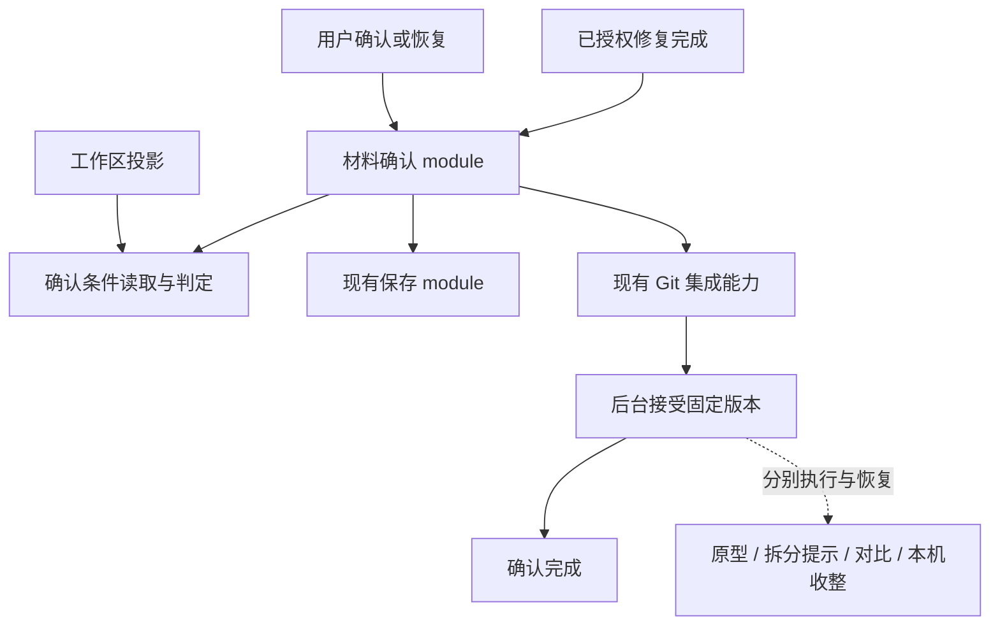

# 材料确认 module 深化设计

状态：2026-10-24 用户已确认完整设计并完成代码实现；验证记录见文末。此处的实现验证不表示真实桌面及企业协同环境已经验收。

## 目标与已确认决策

材料确认 module 统一编排场景与需求的保存、检查、固定候选提交、项目接受及失败恢复。它持有贯穿全程的确认记录，决定下一步和恢复入口；现有保存与 Git 集成 module 继续负责各自的执行、回执及幂等处理。

固定版本被协同后台接受即完成材料确认。原型启动、需求拆分提示、一致性对比及本机任务收整由各自职责处理；这些后续动作的失败不得改写已经成立的确认结果。

领域定义见 [CONTEXT.md](../../CONTEXT.md)。本次沿用 [场景修复授权](../adr/0001-scenario-repair-confirmation.md)、[共享投影与读取车道](../adr/0002-workbench-projection-ownership.md)、[独立一致性对比](../adr/0003-user-directed-revision-consistency.md)和[后台 Git 车道](../adr/0005-local-record-rebuild-and-background-git.md)的决定。

## 当前摩擦

- `StudioApplication.validateDesignConfirmation` 改写当前选中材料并读取完整工作区投影，再次检查投影已经检查过的依据文件。确认需要知道来源、会话和界面投影的组装方式，locality 不足。
- `checkScenarioDocument` 的 interface 接收调用方预组装的权限、占用、版本、模板及文件事实；投影与 AI 修复各自收集这些事实。只移动判定函数不能增加 depth。
- 需求保存已经由 `RequirementSaves` 集中处理原请求与部分成功事实，但后续确认意图、候选准备、集成与恢复仍由 `studio.ts` 串联。
- 集成接受后，后续业务动作仍位于同一个恢复方法中；接受事实与后续失败信息应分别归属。

## 职责与复用

材料确认 module 的 interface 表达发起、查看与恢复一次确认，不向调用者暴露保存、承认答复、候选提交等需要手工排序的步骤。内部 implementation 复用现有能力，不建立通用工作流框架或额外可插拔 adapter 配置。

- **确认记录**：固定账号、项目、材料、原编辑任务及本次明确输入和确认依据；关联保存、固定候选及集成回执。恢复依据原记录，不能从当前选中材料推断原现场。
- **保存**：需求关系、正文、目录的部分成功处理沿用 `RequirementSaves`；文档条件写入、冲突保留及回执沿用 `ScenarioDocumentService`。普通保存仍可独立使用这些 module。
- **已保存输入**：场景的 hash 确认入口承接既有本地草稿保存，建立记录时保留该 hash 对应的正文与元数据；外部随后修改文件，不得抹掉原输入或让原确认改用新内容。
- **检查**：集中读取当前材料、模板、权限、有效设计占用及依据文件，再调用现有领域判定。展示与实际确认共享判定 implementation；实际确认重新核对，不以旧投影作为写入授权。
- **候选与集成**：保留精确内容 hash、原候选、条件推进分支及后台接受核对；与原型确认共享的候选和集成实现只保留一份。
- **后续动作**：消费明确的接受结果；各自保留必要的恢复事实，重试确认不得重新声明或撤销接受结果。

唯一流程所有权增加 locality；场景、需求与已授权修复复用确认链，形成 leverage。新增文件必须承接完整职责，不把每个步骤拆成 shallow module。

## 实施拆分

| 位置 | 承担职责 | 复用关系 |
| --- | --- | --- |
| 新增 `host/application/material-confirmations.ts` | 发起与恢复完整确认、贯穿记录、可信门禁事实收集、普通与已授权修复确认。 | 复用 `RequirementSaves`、`ScenarioDocumentService` 和 `AuthorReviews`；投影与修复通过窄职责回调共享检查，不反向调用完整 `snapshot`。 |
| 新增 `host/application/fixed-candidates.ts` | 本次固定输入、材料路径归属、提交白名单、评审快照及固定候选制作。 | 材料确认、原型确认及评审请求共用现有 `prepareContent`／`prepareCandidate` 的 implementation。 |
| 新增 `host/application/git-integrations.ts` | 原操作查询、候选推送、后台准备、条件推进与接受核对。 | 材料及原型共用固定提交接受协议；模板仅在机械推进部分确有复用时使用，不并入材料确认。 |
| 现有 `host/application/studio.ts` | 命令路由、构造期组装、单写者队列、后台车道及接受后的领域编排。 | 项目、原型、采用、交接、对比和收整沿用已有职责，不新增通用事件总线或后续动作框架。 |
| 现有 `scenario-workspaces.ts`、`scenario-repairs.ts` 及 `state.ts` | 使用确认 interface、保存本机确认与子操作记录，继续持有编辑与修复任务自身状态。 | 将需求专用确认编排替换为统一材料确认编排；保留修复授权和预算的原所有者。 |

以上路径相对于 `packages/studio-plugin/src/`。拆分时删除移出的旧方法，调用者一次性改用新 module，不保留转发兼容方法或重复 implementation。

## 持久化、调度与接受交付

首次保存之前建立确认记录，固定本次操作身份、内容与确认依据；已创建的候选、保存请求和集成请求均由原记录关联。固定候选前持久化输入与评审 HEAD，提交完成后、候选回执保存前中断，也必须核对原提交的父关系、范围和字节并沿用原评审快照。恢复先核对这些既有事实，不重新生成身份或依赖当前选中项目。

固定原任务的工作树、用途和占用身份。当前 `PendingOperation` 只记录材料身份、恢复时按材料查找第一个任务，这不足以区分同一材料的编辑、原型与历史任务；统一后必须核对原现场。

收到完成答复后显式核验后台已接受，并持久保存确认 ID 与固定版本。接受完成后再向后续职责交付，不将后续动作失败写回确认的失败状态或消息。接受事实保留供重放交付；各职责先保存自己的待办，再执行，以确认 ID 和固定输入识别重复交付。

现有后台车道会记住成功键，后续动作须使用自身的调度身份，不能继续借用原确认的 `operation:<id>` 重试。同账号不同项目允许同名操作，调度与恢复身份必须包含项目。一致性对比沿用确认 ID，采用成功沿用 `AdoptionOperation.success`，交接沿用 `task.handoff`，本机收整沿用 `task.cleanup`；原型启动补齐任务自有的启动进度。外部会话或提示发送结果未知，以及发送成功后的最终回执落盘失败，均保留待核对，不假设具备幂等回执，也不盲目重发。

自动原型启动遇到后来新建的设计占用时停止并保留修订现场，不能取消它来恢复旧待办。设计与原型任务创建均捕获原账号及目录，在外部等待前后核对，避免账号切换后继续创建或登记任务。

本机记录使用明确的 `formatVersion` 标记。旧格式按 ADR-0005 原样保留并重建，沿用原 `clientId`；不迁移旧确认意图，也不将缺少原任务身份的待办解释为当前格式。

本机收整继续等待一致性对比完成本地输入读取，以免过早释放工作树；不等待模型或对比提交，材料确认的完成答复也不等待这些动作。模块组装沿用构造期注入，避免循环导入；后台车道中的工作不得等待排在自己之后的任务。

## 直接沿用的行为约束

这些规则已经由现有设计或 ADR 确定，不在本次重构中重新定义。

1. 同一操作身份对应固定输入与确认依据；不同的用户选择使用新操作身份。旧请求和已经生效的结果保留供核对。
2. 需求正文与关系已保存、仅目录更新未完成且内容及占用未变时，允许自动核对并补完。其他恢复按实际异常提供可执行选择。
3. 答复未知先核对原操作；不得因重试重新确认、重建替代候选或自动撤销已生效的关系。
4. 内容、占用、权限或来源变化时重新验证；需要用户判断的内容变化进入恢复选择，不以原请求覆盖新输入，不自动重新认领编辑权。
5. 普通确认、AI 辅助评审确认与已授权 AI 修复确认保留各自的授权证据。修复轮次、补答与终止条件仍由修复 module 持有；后台接受前不能显示已确认。
6. 命令及自动保存恢复遵守单写者队列。Git 同步与集成在后台车道执行，投影读取不等待它们，不因读取而执行确认。
7. 一致性对比独立、非阻断；其失败不进入确认门禁。系统预置通用场景继续由项目初始化接受，不走普通材料确认。
8. 旧实现直接删除，不引入兼容层、数据迁移或失败后的另一套确认实现。

## 验证与验收

测试通过完整 module 的 interface 驱动，并用受控 adapter 注入文件变更、占用变化、答复丢失和后续动作失败；不再通过替换私有 `confirmMaterial` 跳过确认链。

- 保留既有需求保存、文档冲突、完整命令确认及 Client 恢复测试。
- 验证保存后的精确内容进入确认，投影、手工确认与修复遵循相同条件；确认不改变界面当前选中材料。
- 在保存、固定候选、集成准备、分支推进及后台接受的关键位置中断或丢失答复，恢复仍核对原请求、原候选及原任务，重复恢复不产生重复确认。
- 同一材料存在多个任务时，恢复使用原编辑现场；账号、项目及占用变化不得让旧操作写入另一现场。
- 后台已经接受后，即使原型或其他后续动作失败，确认结果保持完成，后续动作可按各自入口恢复。
- 验证慢 Git、自动目录恢复和失败恢复不阻塞投影，并保持既有原型确认共用路径。

运行相关 Host 与 Client 测试、Host 类型检查及仓库必需检查；本机替身测试与真实 Git／数据库验收分别报告，不将环境缺失导致的跳过计为通过。

## 实施验证记录

2026-10-24 完成以下验证，均为当前源码及本地生成装配树的结果：

| 验证 | 结果 |
| --- | --- |
| `EADP_TEST_DSH_ROOT=.local/build/dsh` 下运行 `tests/windows-desktop/*.test.ts` 与 `tests/gitlab-auth-host/consistency-host.test.ts` | 283 项通过，0 失败，0 跳过；含实际 DSH 工作目录解析检查。 |
| `node --test tests/scenario-client/*.test.mjs tests/scenario-client/*.test.ts` | 97 项通过，0 失败，0 跳过。 |
| 通过受维护的 `prepare-studio-plugin.mjs --dev-stage` 生成装配树，再运行 Host／Client `tsc -b` | 通过。 |
| `pnpm --filter @eadp/collaboration-api typecheck` | 通过。 |
| `pnpm check:repository`、`git diff --check` | 通过。 |

新增行为验证覆盖：候选提交后的中断与原评审快照恢复、改名删除范围、未知接受答复、原任务替换、跨项目恢复、无占用迟到确认、后续提示发送未知、发送成功后落盘失败、新修订不被旧待办取消、等待期间切账号，以及跨项目同名操作各自启动。原先替换私有 `confirmMaterial` 的需求确认测试已改为经完整确认链运行，只有外部 Git／协同能力使用测试 adapter。

这轮确认链验证使用临时文件、真实本机过程存储与受控 Git／协同 adapter；没有执行企业 GitLab、真实 PostgreSQL 或桌面界面的完整业务验收。
