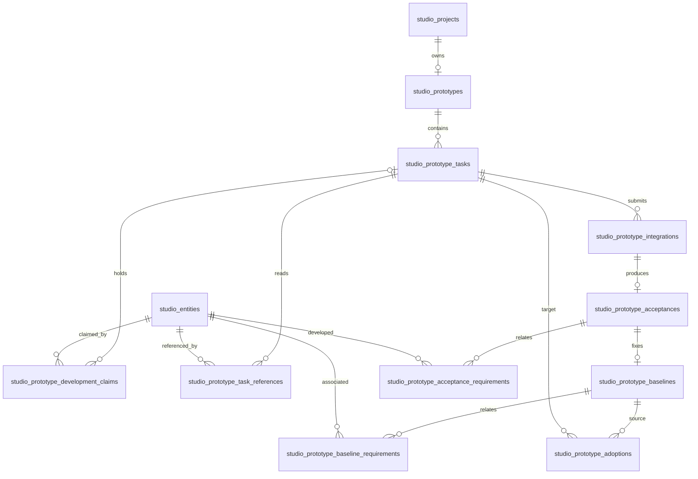

# 项目原型数据模型

本页说明当前 [SQL 定义](../../../apps/collaboration-api/db/schema.sql) 中原型相关表的职责与关系；它不代表事务、权限或桌面操作已经运行验收。原型集成与恢复规则以[协同契约](collaboration-contract.md)为准，尚未关闭的工程事项见[技术设计](technical-design.md)第 11 节。

项目初始化时建立唯一的 `studio_prototypes` 身份；初始化之前可尚无该记录。`current_baseline_id` 指向已接受的原型基线，而项目 `recognized_head` 表达项目 Git 认可头。两者是不同事实：材料集成可以推进认可头而不创建原型基线。

`studio_prototype_tasks` 记录所有者、设备、分支、起点、source 基头、写入范围、策略哈希及代次／修订。`studio_prototype_development_claims` 中每个活动需求的 `(project_id, requirement_id)` 由部分唯一索引约束；管理员将空闲需求置为占用时可创建不归属任务的占用记录，它不授予客户端写入权。参考关系保存在 `studio_prototype_task_references`，不取得开发权。关联需求及开发占用均不代表业务用例通过或需求实现覆盖。

`studio_prototype_integrations` 保存原始固定请求、source、预期头和候选头，以及 prepared／accepted／aborted 状态。SQL 分别约束原型集成在项目中的 prepared 唯一性；与材料集成之间的竞争还依赖应用的项目事务锁和联合检查，不能由单个索引单独证明。prepared／accepted 的 `git_recovery` 为 NULL；主动 abort、取消或释放将 prepared 置为 aborted 时，同事务写入 `git_recovery='pending'`，并保留其集成请求及 SHA 用于核对可能晚到的 Git 操作。只有受管理员保护且已验证 corrected tree 与原 recognized tree 完全相同的 reconcile 成功事务，才把本项目 prepared／pending aborted 记录收敛为 aborted／`reconciled`；accepted 及其基线不变。取消或释放响应中的即时 `gitRecovery` 仍只表示当次 Git 头观察，不覆盖持久 pending。任务 source-base 更新只被本任务仍为 pending 的 aborted 历史阻止，已 reconciled 的记录不再形成永久阻断。

后台接受事务写入 `studio_prototype_acceptances` 和 `studio_prototype_baselines`：前者记录本次确认、source、candidate 和本次开发需求，后者固定完整原型提交并记录累计关联需求。`studio_prototype_adoptions` 引用来源基线和目标事项，可在成功时引用目标基线。交接材料引用基线 ID 与提交 SHA；项目部署引用原型基线。材料自身的固定版本和确认仍由材料模型管理，不随原型接受自动完成。

本机开发队列、需求开发程度、逐项成果核对、纠偏、编辑缓冲、读取记录、候选审阅和检查过程不属于上述数据库表，也不能从后台基线反推出用户未提交的本地草稿或模型会话。

2026-10-29 用户已明确：每次开发前由后端原子检查并领取占用，每次标记携带 commitId，但未占用时按标识原子领取，不要求远端 commit 一致；管理员可主动修改标识并失效旧代次；已有占用的正常成果同步仍核验远端；首次 AI 完成经 hook 自动推送、核验后释放，纠偏重新领取并持有至用户最终确认、推送核验后释放。中断后核对后台与 Git 并自动继续，本地缓存不作授权依据，详见[本地开发协议](local-development-protocol.md)。该生命周期取代活动任务 claims 只增不减、整任务结束才释放的旧规则；历史 claim 不能授权再次写入或提交过期成果。远端引用读取与数据库释放之间的竞态仍未解决；本文的数据结构说明不代替当前版本的并发与桌面闭环验收。
