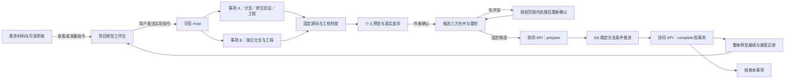

# 从需求到原型的技术设计

状态：2026-10-26，两轮八项业务决定已确认；按用户后续关于同需求互斥、成熟组件及本地浏览器验证的追问补充技术方案。按现有设计安排开发；具体技术方案的验证结果以实现和验收记录为准。交互依据为[原型工作台设计](../03-prototypes.md)与[HTML 设计稿](../../dseign/原型交互工作台.html)；业务语言见[CONTEXT.md](../../../CONTEXT.md)，架构边界见[ADR-0008](../../adr/0008-project-prototype-parallel-collaboration.md)。

## 1. 已确认的目标与边界

1. 项目原型将多项需求组织成一个可以连贯操作的页面与 Mock 应用；需求集合用于查看、理解与定位，不是开工前锁定的固定输入包。
2. 多人各自分支并行修改，再集成到同一项目原型；不采用项目独占编辑方案。
3. 需求依赖保留为顺序提示，取消原型开工及确认时的前置需求完成门禁；同项目、无重复、自引用及环检查仍属于需求关系自身的规则。
4. 明确的实现或修改指令授权 AI 在 Host 允许的代码范围内直接写入；需求 Markdown 修改仍回需求阶段审阅写入。写代码、确认成果和发布是不同授权。
5. 确认整体原型成果并形成代码基线，记录实际涉及的需求；需求状态独立保留，不将集合中全部需求批量置为原型完成。后续可继续修改并确认新基线。
6. 正式基线固定的是已接受的成果版本，不固定下一轮协作的实现依据；切需求、页面或文件不能重建会话或切成单需求工作台。
7. 按一个协作事项建立任务，可跨多个需求；同一事项多轮对话沿用分支、工程和会话，确认集成后结束该事项，不按每条消息建立分支。
8. 无冲突合并最新认可成果后，重新检查并继续原确认；有冲突则由 AI 在原授权范围内解决，展示新差异及预览，再由用户确认新成果。失败保留现场，允许人工处理或取消本次提交。
9. 允许参考本人工作区可读的需求草稿进行原型探索，明确实际读取的是草稿；材料后来更新只提醒影响，不重绑固定依据。原型确认不替需求确认。
10. 需求确认后只提示进入原型及准备实现指令，用户发送后才实现；取消每条需求被接受后自动打开会话并发送实现提示的旧行为。

补充约束：多人并行的单位是不同需求的协作事项，同一需求不能同时属于两个活动开发任务。上一版 TaskRequirement 仅作关联，不能满足这一要求；现补充独立需求开发占用方案。数据库唯一约束与事务原子领取负责互斥，Git worktree 负责文件现场隔离，两者分别解决问题。需求可以未确认、可以跨多项、可以动态扩领；不固定材料版本，不恢复前置完成门禁。

2026-10-27 用户确认开发队列“默认串行，手动继续或切换”。一个队列项对应一个协作事项，可包含多个需求；本人当前客户端的 AI 实现串行，其余事项保持有效认领并持久排队。正常关闭及重启不取消任务、不释放开发占用；恢复原现场、核对未知操作后，由用户明确继续才启动新一轮模型。具体持久字段和恢复顺序见[桌面运行时](desktop-runtime.md)。

## 2. 成熟模式与技术路线

沿用已固定 DSH 桌面、原生会话、可信 Host、协同 API、Git 和随包 Umi 模板，不因界面参考引入新的宿主、框架或外部服务。当前模板为 React 18／Umi 4，包与运行工具版本以仓库锁文件为准。

- [Git worktree](https://git-scm.com/docs/git-worktree)支持同仓库多分支独立检出，适合成员并行现场。它解决文件现场隔离，不代替后端授权、占用代次、项目接受和操作幂等。
- [VS Code 源码管理](https://code.visualstudio.com/docs/sourcecontrol/overview)采用文件树、真实文件差异和提交快照；本设计沿用查看文件及差异的模式，由 Host 提交固定候选，避免把会话“完成”声明当作正式成果。
- [Git merge-tree](https://git-scm.com/docs/git-merge-tree)提供三方合并树计算，支持内容与重命名冲突。Host 构造候选，后台独立计算原型子树验证干净合并，不自行实现一套文本合并算法。
- 本地预览仍消费经过检查的静态构建产物与合成 Mock，运行状态、工程检查和用户业务核对分别表达。预览页面无工作台命令权限；外开本地预览不等于部署。

协同 API 需要新增验证用 Git 运行工具：当前 `apps/collaboration-api/Dockerfile` 未安装它，版本路线沿用桌面运行锁的 Git 2.56.0 系列，实施时锁定 Linux 构建摘要并验证与 Host 的合并策略一致性，更新镜像、许可清单及运行资源限制。它作为独立进程使用；具体许可原文见 [Git COPYING](https://raw.githubusercontent.com/git/git/master/COPYING)。仅临时处理原型代码子树，不克隆完整业务仓库、不留正文缓存。详细取舍与验证方法见[后台契约 6.1](collaboration-contract.md#61-后台验证候选树)。当前未安装或修改服务，不把这一设计记为已有能力。

桌面新增明确选型：编辑器采用 CodeMirror 6；业务验证采用独立锁定的稳定 Playwright 1.61.1 与其配对 Chromium，复用固定 DSH 会话／MCP／附件生命周期，保留 Electron 对实际桌面预览的保护检查。须承担新增依赖、浏览器分发和回归成本。完整组件版本、许可、复用边界和验证操作见[技术选型与本地浏览器验证](technology-and-browser-validation.md)。

同需求互斥采用 [PostgreSQL 部分唯一索引](https://www.postgresql.org/docs/current/indexes-partial.html)与已有项目短事务，不新增 Redis 锁或 TTL 抢占。浏览器采用 [Playwright 的定位、断言、隔离与 trace](https://playwright.dev/docs/intro)，不自研自动化引擎；固定 DSH 接口、打包版本和专属浏览器隔离随对应开发工作包实现并验证。

## 3. 当前源码证据与需要替换的模型

以下为 2026-10-26 当前文件静态调查；行号是本轮定位线索，未运行真实桌面、模型或远端验收。

| 链路 | 当前事实／源码位置 | 对技术设计的约束 |
| --- | --- | --- |
| 需求确认后衔接 | `packages/studio-plugin/src/host/application/studio.ts:745-758,795-822` 在需求被接受后记录固定引用，后台打开原型会话并发送实现提示；失败不回滚需求确认。 | 必须明确项目级并行任务如何承接该动作，不能每条需求无条件再建一个独立原型。 |
| 原型任务 | 同文件 `:683-707` 按单 requirement 认领、创建 task worktree，以需求 hash 复用；`:556-580` 恢复要求材料版本和前置完成绑定不变。 | 改为项目原型协作任务身份，保留个人独立现场；删除单需求固定输入和前置完成依赖，不用兼容字段掩盖语义改变。 |
| 原生会话 | `packages/studio-plugin/src/host/adapters/dsh/sessions.ts:74-125` 经官方 preset mount 后 create/resume，载入模板规则及受控文件工具。 | 沿用原生会话与 Host 工具保护；跨需求查看不改变会话归属。 |
| 模板与边界 | `packages/studio-plugin/src/host/prototype/template.ts:71-126` 核验模板与保护文件；当前写入范围由 manifest 业务目录白名单约束。 | 原型按已有项目工程演进，不每轮覆盖模板；任务授权须覆盖实际共享页面和组件，不能机械按需求分文件所有权。 |
| 检查与预览 | `packages/studio-plugin/src/host/composition.ts:56-82,123-125` 缓存检查并运行静态预览；`prototype/checks.ts:29-55`、`preview.ts:16-43` 校验源码、规则、产物与实例。 | 证据必须绑定确切工程和候选；当前内存缓存与单预览实例不能冒称已支持多任务恢复。 |
| 浏览器保护检查 | `apps/desktop-distribution/build/studio-browser-check.ts:15-46` 检查 Mock ready、未知请求、网络围栏及非空页面。 | 属于技术检查，不证明订单、审批、供应商业务正确。 |
| 集成粒度 | `apps/collaboration-api/src/modules/integration.ts:68-74` 强制只确认被占用的一个实体；contracts `src/index.ts:120-124` 同样绑定 entity/token。 | 需要原型任务与原型成果的明确契约，不能把一条内部需求完成冒充整体确认。 |
| 前置门禁 | `packages/asset-domain/src/index.ts:122-130` 要求前置需求指定版本有完成证据，`occupations.ts:9-24,44-47` 在认领和完成重检。 | 按本轮已确认决定删除原型阶段该阻断，保留需求关系语义与合法性校验。 |
| 基线 | `integration.ts:103-110` 生成单需求基线，SQL `apps/collaboration-api/db/schema.sql:837-850` 将 baseline 唯一绑定需求及材料版本。 | 基线改为整体原型成果版本，不以需求 materialVersion 限制只能确认一次，也不回写全部需求完成状态。 |
| 事务与恢复 | `apps/collaboration-api/src/service.ts:52-60,219-236`、`integration.ts:81-89,121-133`、`persistence/repository.ts:295-314` 已有项目短事务、固定候选、原操作查询及幂等。 | 可沿用控制机制；并行编辑与串行接受分别处理，网络／Git 操作不放长数据库事务内。 |
| 原型并发合并 | `packages/studio-plugin/src/host/application/studio.ts:85-86` 仅 material 进入候选自动合并；原型认可头变化仍报错／待核对。 | 并行分支的集成必须补上原型候选合并、重检、冲突恢复与授权边界。不能靠无限重试消除分歧。 |

静态发现：`apps/collaboration-api/src/persistence/repository.ts:156` 插入 `studio_occupation_inputs` 未提供 `project_id`，而 `schema.sql:775` 定义该列 NOT NULL 且无默认；现有触发器只校验引用。非空前置绑定预计失败，尚未做数据库复现。它属于现有单需求模型的风险，后续应随旧原型完成输入模型替换处理；本轮不据此扩展到无关修复。

## 4. 决策树与轮次记录

```text
项目原型：多需求、持续演进、无固定单需求依据（设计稿已明确）
├─ Q1 协作方式：多人各自分支并行集成（已确认）
│  ├─ Q5 任务边界：按协作事项，多轮沿用，接受后结束（已确认）
│  └─ Q6 合并：干净合并重检继续，冲突处理后用户重确认（已确认）
├─ Q2 需求依赖：仅提示，取消前置原型完成门禁（已确认）
├─ Q3 代码写入：实现指令授权范围内直接修改（已确认）
│  └─ Q7 草稿：允许探索，真实标注，更新只提醒（已确认）
└─ Q4 确认对象：整体原型成果，需求状态独立（已确认）
   └─ Q8 需求衔接：提示进入并准备指令，用户发送后实现（已确认）
```

已确认项即时同步领域术语和相关设计。当前业务分支已收敛；以下工程取舍作为开发依据；实现中发现无法满足的约束时记录证据并回到设计解决。若审阅发现新的业务分歧，重新展开对应分支，不以工程默认值代替业务决定。

本轮补充检查分支：同一需求重复开发风险 → 持久排他开发占用；多需求任务 → 原子全领或回滚；动态扩范围 → 新增领取成功后再允许写入；共享组件 → 不同需求仍可分支并行，最后合并与业务核对；浏览器验证 → 区分现有技术保护检查与真实业务操作证据。补充方案不是上一版已经实现的能力。

## 5. 整体架构与规范分工

本文件负责整体流程、不变量、实施拆分和验收；[桌面与 Host 设计](desktop-runtime.md)定义本地命令、事件、会话、文件、检查与预览；[协同契约设计](collaboration-contract.md)定义 HTTP、类型、SQL、后台事务及 Git 候选验证；[组件选型与浏览器验证](technology-and-browser-validation.md)定义成熟组件、成本、专属本地浏览器及证据流程。四份文件组成同一技术设计，不各自引入业务规则。



业务界面始终是一个项目原型；“我的协作事项”在会话区／轻量下拉中切换。项目原型身份、协作事项身份、原生会话身份和接受事件身份分别维护。会话中看另一个需求、页面、文件，不切换事项或原生会话。

多人以已接受的项目成果为共同起点。各自拥有独立工作现场、编辑缓冲、会话、构建与预览实例；不同需求涉及共享组件时仍可在不同分支修改，Git 集成时解决冲突。同一需求的开发权由 PostgreSQL 持久记录及唯一约束排他持有；数据库项目行锁只保护领取／扩领／接受的短事务，不覆盖整个开发过程。

## 6. 端到端用户路径

| 步骤 | 用户可见结果 | Host／后台行为及失败边界 |
| --- | --- | --- |
| 需求确认完成 | 需求显示已确认，提供“进入原型”。 | 不自动启动模型；入口失败不回滚需求确认，稍后仍可从项目原型进入。 |
| 用草稿探索 | 清楚看到材料草稿身份，可先讨论和验证。 | 仅从 Host 已登记的本人同项目可读现场读取；不复制私有草稿到基线或后台，不遍历其他成员私有目录。 |
| 打开原型 | 看到项目已接受成果，或自己的现有事项。 | 查看、检查、预览不暗中创建任务或取得写权限；已接受成果在本机隔离运行目录中检查预览。 |
| 准备实现指令 | 原生输入框保留可修改草稿。 | 不发送模型、不认领、不自动创建分支。 |
| 首次发送实现 | 当前没有运行事项时开始本事项；已有运行事项时保留首次指令并加入队列，等待用户手动切换或继续。 | Host 从明确指令解析实际开发需求并原子领取；若已被占用，显示开发者及事项，不发送可写实现指令。领取、范围、现场与发送分步记录和恢复，按[桌面运行时](desktop-runtime.md)执行；无需预先填写固定版本输入包。 |
| 多轮调整 | 对话、变更卡、代码与页面协作更新。 | 复用事项与原生会话；代码范围内直接写入，越界或保护文件拒绝；涉及新开发需求时先原子扩领，冲突保留原现场。参考阅读不领取；业务范围身份不明时先只读澄清。 |
| 查看需求集合 | 查看项目目录、事项实际涉及及历史涉及需求，定位页面／代码。 | 三类集合分别表达；不宣称集合成员全部实现、已完成或已确认，不要求预选才能工作。 |
| 代码编辑 | 显式编辑，保存后呈现真实差异。 | 文件 expectedHash、受控路径和写队列防止覆盖；外部变更保留双方，由用户选择内容。 |
| 检查／运行 | 显示当前工程的技术结果与预览。 | 使用受管工具与独立实例；修改源码使旧证据过期；不将保护检查等同于跨页面业务验收。 |
| 确认整体原型 | 查看当前成果与真实检查，明确确认一次。 | 从精确工程树归一 sourceSha，记录实际变更和允许干净合并后重检的确认意图；不改原多轮分支历史，不批量改需求状态，不增加逐项核对勾选门禁。 |
| 并行集成 | 干净合并时展示合并与重检进度；有冲突时回到新成果审阅。 | 候选只含本次确认修改与已接受成果；冲突解决后新 source／新确认，结果未知先查原操作。 |
| 接受成功 | 展示整体基线，本事项结束，可查看交接入口。 | 基线、接受事件、事项结束与认可头同事务；本机收尾和后续交接独立恢复。继续编辑建立新事项。 |

“取消模型本轮”只中断本轮，保留已写代码；“取消协作事项”终止该事项后端接受权并保留唯一成果。存在已推送或未知结果时先查原操作；已接受的事项不能在界面改成取消。

## 7. 必须保持的不变量

1. **需求与原型分别确认**：需求材料版本与前置完成不充当原型开工、恢复、检查或接受门禁；原型接受不回写需求 completed。同需求排他开发权是防止重复开发的准入条件，不能用关联提示代替；读取参考和材料修订不取得或转移开发权。
2. **授权在 Host 与后台落地**：持久任务范围与项目／模板保护策略共同限定代码写入；请求自报的 allowedPaths 只表示实际候选变更，不能扩大任务权限。普通 AI 与预览页面没有确认、发布工具权限。
3. **分支隔离不等于项目接受**：本地保存、模型结束、检查通过、source／candidate 私有引用上传、稳定分支推进、后台接受和本机收尾分别记录。先上传不可变私有引用供后台按 SHA 验证，prepare 后才能条件推进稳定分支；私有引用可读不表示已接受。
4. **基线是完整成果**：当次已确认修改与既有已接受成果共同形成完整源码快照；不带其他成员未接受分支或私有草稿。原型基线有自身序号，不复用需求 materialVersion。
5. **检查只证明确切工程**：工程 SHA-256 指纹、Git commit SHA、Git tree ID、构建产物 hash、工具／规则版本分别表达。不能将一种 hash 充当另一种，也不能复用代码变更前的证据。
6. **干净合并有明确派生链**：初次用户确认绑定本人 sourceSha；自动合并只允许加入已认可成果，按固定策略计算并验证候选树，重检后继承原确认意图。新增业务改动、授权范围变化和冲突修正需要新确认。
7. **后端接受是短事务**：项目级 prepared 单赢家，编辑期多任务并行；prepare 与 complete 都检验任务 owner、client、generation、revision 与当前候选。正文、代码、会话与完整工具日志不进协同数据库。
8. **Git 与数据库不假装原子**：撤销任务能阻止后台接受，不能撤回已发出的 Git 请求。真实远端头偏离认可头时阻止后续接受／发布，按已有受保护 reconcile 恢复，不能把任意远端头宣布为已接受。
9. **未知结果不重复写**：原操作幂等键绑定原输入；查询到 accepted 返回原基线。改变候选、范围或重新确认用新键，并保留旧操作定位。
10. **草稿与运行现场受保护**：取消、退出、模型失败、检查失败和授权失效均不自动删除未接受代码与唯一输入；接受后收尾失败不撤销接受事实，不让用户重复确认。
11. **基线与认可头分别表达**：后续材料确认可推进全项目认可头，原型基线仍指向其准确 commitSha；发布及交接读取显式基线，不偷换为最新工作树或认可头。
12. **任务 revision 与提交不互相破坏**：prepared 期间不更新正式任务关联或写入范围；本地实际阅读观察不修改后端任务 revision。撤销本次集成与取消整个事项分别提供操作，已推进远端或结果未知时先核对，不能用 abort 宣称外部 Git 副作用已撤回。
13. **同需求单任务开发**：唯一键是项目与需求身份，不含用户、客户端或需求版本；同一人开两个任务也不能重复领取。活动任务开发需求只增不减，接受／取消／释放时同事务结束全部开发占用；任务的参考集合不赋予写权限，不能借空开发集合或共享组件名义绕过占用。

## 8. 实施拆分与删除范围

以下是按现有设计执行的开发顺序；各工作包同时完成对应验证，当前均待开发。

| 编号 | 实施单元 | 主要位置与验收产物 | 前置 |
| --- | --- | --- | --- |
| PT01 | 原型身份、事项、需求开发占用、接受与基线模型 | contracts、asset-domain、API modules／persistence、schema.sql；开发需求部分唯一索引、多需求原子领取、同项目关系与原子接受约束。 | 已有设计与业务边界 |
| PT02 | 后台候选子树验证器与服务镜像 | 扩展 Git 内容适配器；固定 Git 运行工具、原型子树合并校验、临时对象生命周期及对照用例。 | PT01 |
| PT03 | 事项队列、现场、原生会话与材料读取 | Host application、DSH adapters、state；账号隔离持久队列、手动串行调度、关闭／重启恢复、按事项 create／resume、草稿读证据、持久范围与撤销恢复。 | PT01 |
| PT04 | 原型文件服务与真实编辑 | shared、Host 文件读写、客户端原型代码区；文件 hash 冲突、原子保存、保护区拒绝、缓冲恢复。 | PT03 |
| PT05 | 工程证据与多预览实例 | prototype checks／preview、composition、桌面浏览器检查；持久证据失效、受控进程与端口隔离。 | PT03 |
| PT05B | 成熟编辑器与本地浏览器业务验证 | CodeMirror 6、稳定 Playwright／配对 Chromium、DSH 受限 provider 与附件、业务用例／trace、安装分发；在实现中验证固定版本组合，不升级宿主或放开完整 MCP 工具。 | PT03、PT04、PT05 |
| PT06 | 作者确认、原型集成与恢复 | Host candidates／git integrations、API complete；干净合并重检、冲突新确认、unknown、撤销竞争与接受后收尾；同步交接、原型包复用和发布消费者，显式读取 baselineId／commitSha。 | PT02、PT04、PT05 |
| PT07 | 统一原型工作台和需求衔接 | client/studio、shared、需求确认结果；轻量事项入口、需求集合、文件与预览／输出、确认面板，删除自动实现。 | PT03—PT06 |
| PT08 | 旧协议删除及真实桌面验收 | 删除旧单需求原型生产占用及前置完成输入，替换为独立需求开发 claim；删除 completion 与基线绑定，同步交接／复用消费者并记录下表实测。 | PT01—PT07、PT05B |

具体旧字段、表和索引清单见[协同契约第 8 节](collaboration-contract.md#8-sql-替换清单与不变量)，Host／Client 替换点见[运行时第 9 节](desktop-runtime.md#9-模块职责与替换点)。材料确认及其修复流程仍保持自身职责；不得顺手把原型的冲突重确认规则改成材料流程的新规则。

当前开发数据不新增 migration、兼容分支或 fallback。执行前识别唯一未提交草稿与活动事项，按项目保护规则保留可核对原件；不能以删除旧数据结构为由覆盖或丢弃它们。每项实现同步类型、校验、持久化、设计和受影响检查，不保留一套新协议配一套旧状态的中间交付。

## 9. 验证矩阵

以下均为待执行验收用例；静态文档核对不勾选产品通过。先运行有意义的契约／领域／Host 局部检查，再使用指定服务完成当前桌面闭环。

| 用例 | 操作与故障 | 可核对结果 |
| --- | --- | --- |
| PA01 | 确认需求后停留、退出，再点击进入原型。 | 需求确认独立成功；没有自动模型请求、任务或分支；指令只在用户发送后实现。 |
| PA02 | 从未确认草稿进入原型，多轮查看订单、审批、供应商。 | 草稿身份真实；同事项与同会话；无固定单需求依据、前置完成或集合预选门禁。 |
| PA03 | 两成员同时创建跨需求事项并修改不同代码。 | 任务、分支、会话、缓冲、构建及预览独立；没有项目编辑独占。 |
| PA04 | 无事项时查看已接受成果并检查预览。 | 不申请写 token，不启动模型，安装／构建不改用户业务工程。 |
| PA05 | 实现中更新需求草稿或接受新的需求版本。 | 提示实际变化与读取范围；不切事项、不重绑、不改原型代码或材料状态。 |
| PA06 | 同文件手工编辑与 AI／外部进程写入交错。 | expectedHash 冲突，双方输入可恢复；无静默覆盖；保存路径原子替换。 |
| PA07 | 尝试改 package、锁文件、Mock 初始化、保护规则或链接越界。 | Host 拒绝；请求改写 allowedPaths 不能绕过后台持久 scope。 |
| PA08 | 两事项同时运行；占用默认端口；停止其中一个。 | 使用不同受管实例与可用 loopback 端口；不关闭另一实例或其他应用。 |
| PA09 | 检查中改源码；改工具／规则；删构建产物。 | 旧证据失效；不能以旧检查或旧预览确认新源码。 |
| PA10 | 启动失败、Mock 未就绪、未知请求或网络绕过。 | 显示实际失败步骤；技术保护检查失败，源码和会话保留，可修复重试。 |
| PA11 | 中断模型请求、关闭应用、重启。 | 保留已写代码与会话；已发送结果不明不自动重发；正确实例归属后才管理进程。 |
| PA12 | 第一人确认成功，第二人基于旧认可头确认，无文本冲突。 | 重新合并并检查，后台独立校验候选树；第二次基线包含双方已接受成果，不要求重复作者确认。 |
| PA13 | 两人改同一共享文件形成冲突，AI 修正。 | 展示新差异与预览，旧确认失效；用户重确认后才继续接受。AI 失败保留现场。 |
| PA14 | 伪造“干净合并”混入第三人未接受分支、改变保护文件或提交错误 tree。 | 后台拒绝；不只相信 Host 的 clean 声明或检查 hash。 |
| PA15 | 两任务同时 prepare；prepared 被另一事项占用。 | 仅一项目候选受理成功；另一明确等待／刷新；编辑仍可继续，不长锁项目。 |
| PA16 | prepare／complete 与管理员释放或用户取消竞争。 | 已接受事实不撤销；旧代 token 拒绝，晚到 Git 副作用可定位并进入 reconcile，不产生伪基线。 |
| PA17 | Git 已推送后断网；complete 回执丢失；重复点击确认。 | 查询原操作／真实头，只补未完成步骤；只形成一条接受事件与一份基线。 |
| PA18 | 相同 operationId 换内容、身份、候选或授权范围重试。 | 幂等冲突；新输入使用新操作，不篡改旧确认。 |
| PA19 | 后台接受后主检出同步、会话释放或清理失败。 | 显示已接受及未完收尾；仅重试收尾，无再次基线／再次确认，唯一草稿不丢失。 |
| PA20 | 原型接受后继续修改，并再次确认同一批需求的不同代码。 | 新事项、新原型基线序号；不要求需求重新修订，不批量置需求完成。 |
| PA21 | 后续只确认材料，推进认可头；查看／交接当前原型基线。 | 原型 baselineId／commitSha 不变；读取准确成果，不将最新 head 冒充新基线。 |
| PA22 | 取消未接受事项或授权被撤销。 | 保留未提交成果和日志定位；后端接受权失效，不自动删除或伪装已安全撤销 Git。 |
| PA23 | 原型代码未变化，再点确认；仅涉及需求关联变化，再选择查看既有基线或结束事项。 | 不制造相同代码新基线，不宣称新增实现覆盖；查看保留活动事项及占用，明确结束时按取消路径释放占用并保留现场。具体策略待整体确认。 |
| PA24 | 查项目需求目录、事项涉及与基线涉及，尝试查看他人私有草稿。 | 三类范围各自准确，不当作覆盖率；私有内容与越权读取被拒绝。 |
| PA25 | prepared 期间尝试改正式任务关联或授权范围；同时写入只读材料观察。 | 正式更新拒绝，不改变提交令牌；只读观察不改任务 revision，不使已推进 Git 的 complete 意外失效。 |
| PA26 | 任务包含多轮本地提交，固定 source／candidate 后上传私有引用，上传响应丢失。 | 归一 source 的源码树与审阅内容相同，原分支历史保留；后端可按准确 SHA 读取两个对象，查原引用恢复，不把私有推送显示为项目接受。 |
| PA27 | 撤销一次 prepared 并保留事项，模拟晚到 push 或后台已接受。 | 未发生远端推进才正常撤销；已接受返回原基线；晚到副作用有记录并进入核对，事项与集成状态不混淆。 |
| PA28 | 两成员同时开发同一需求，或同用户开启两个任务领取该需求。 | 后台仅一个开发占用生效；另一返回占用者与事项，无第二条可写实现会话。 |
| PA29 | A 领取 R1＋R2，B 同时领取 R2＋R3。 | 整批原子竞争，失败的一批不残留 R3 等部分占用。 |
| PA30 | 活动事项扩领需求遇占用；尝试删除已有开发需求后提交旧代码。 | 扩领失败保留已有现场与占用；开发集合不允许活动期缩减，旧稿不能借变更关联逃过核对。 |
| PA31 | 材料修订形成新版本，两个任务分别尝试按旧／新版本领取同一需求。 | 同一需求 ID 仍互斥；材料修订自身独立，不因为版本变化产生两份开发权。 |
| PA32 | 领取答复丢失、管理员释放后重放历史幂等回执、旧任务再次提交。 | 原操作只生效一次；恢复仍读取当前 claim 与代次，旧回执不恢复已失效开发权。 |
| PA33 | 在专属本地浏览器完成订单必填失败、修正提交、详情核对及保存失败重试。 | 逐步记录真实 DOM 断言／截图／console／trace，输入保留及结果一致；不以页面非空判业务通过。 |
| PA34 | 两任务浏览器并行，尝试跨 target、跨会话截图、外站及其他 loopback 端口；重启预览再用旧工具。 | 拒绝越权与旧代能力；实际监听端验证阻断，不能把原 Electron 围栏或 MCP 参数当作新浏览器已有隔离。 |
| PA35 | 从交付安装包在未预装 Chrome 的干净环境打开原型浏览器，截图回到真实模型。 | 使用随包锁定 Chromium，无首次下载；附件与图像模型接收可核对。Chromium 与 Electron 结果分别记录，不互相冒充。 |
| PA36 | 同人建立多个事项，其中一个包含多个需求；重排队列并重启应用。 | 每事项一项，多需求不自动拆项；顺序、选中项与待继续动作恢复；重排不改开发占用或提交令牌。 |
| PA37 | 当前模型一轮结束，当前事项尚未由后台接受；队列另有待开始事项。 | 显示待用户核对，不把模型结束当需求／原型完成，不自动运行下一项。 |
| PA38 | 当前事项运行中切换另一项、暂停后再继续，或反复点击开始。 | 先让原执行收敛或核对在途结果，本机账号当前客户端最多一个事项 AI 实现运行；重复操作不重复发送。 |
| PA39 | 开发一半，带未保存代码缓冲和聊天草稿正常退出，再重开。 | 已确认持久化的输入、原工作树和会话可恢复；退出不取消事项、不释放 claims、不额外提交／推送 Git。保存失败不假装安全退出。 |
| PA40 | 模型／文件工具／Git 请求在途中崩溃或强杀。 | 原运行标记待恢复；先核对实际写入及原操作，无凭据不盲目重发；最后未落盘击键／token 不宣称必然保留。 |
| PA41 | 应用关闭期间事项已被接受或管理员释放，再打开旧现场。 | 以当前后台事实为准；accepted 仅补收尾，released 只读保留原稿，不用历史 token 重启写入。 |
| PA42 | 重开后原会话或工作树缺失、脏文件有外部修改，或预览进程归属未知。 | 保留记录与可读成果并给出恢复位置，不静默重建覆盖；输入冲突保留双方，不误杀其他进程或沿用旧浏览器能力。 |
| PA43 | 同账号换客户端或离线打开应用，尝试继续原任务。 | 当前客户端须稳定识别；缺少本地唯一现场不能假装跨机恢复，权限／占用未核对时仅允许可验证的只读回看，不自动重领或续跑。 |

每条桌面记录包含交付版本／源码标识、协同服务版本或“未知”、用户与样本、操作步骤、实际候选／基线 ID、必要日志／画面及未验证边界。尚未执行的用例保持未验收，不用局部测试数量替代。

## 10. 本轮交付与验证边界

本轮只设计与源码核对，不修改产品源码、SQL、运行中会话或远端数据，不提交或推送 Git。文档链接及差异检查仅代表文档局部检查。

文档局部核对：9 个相关 Markdown 文件，94 处本地链接、4 处章节锚点全部有效；代码围栏、编码及行尾空白检查通过，`git diff --check` 通过。交叉审查发现的引用可见性、prepared 范围变更、source 归一、独立 abort、状态口径、开发 claim 及浏览器只读 scope／证据目录问题已修正，已补充手动串行队列和正常关闭／重启恢复协议。43 条 PA 验收用例和浏览器验证均未执行；上述局部结果不证明协议、SQL 或桌面功能已实现。

产品实施后必须使用当前交付桌面及既有配置连接 `100.119.183.44`，核对双方版本，执行多需求真实模型会话 → Host → 协同服务 → Git／持久化 → 桌面结果闭环，并覆盖并发、失败和恢复。未知后端版本如实记录未知。当前均未验收，不能以 HTML、源码、工程检查或旧包证据判定产品或生产就绪。
