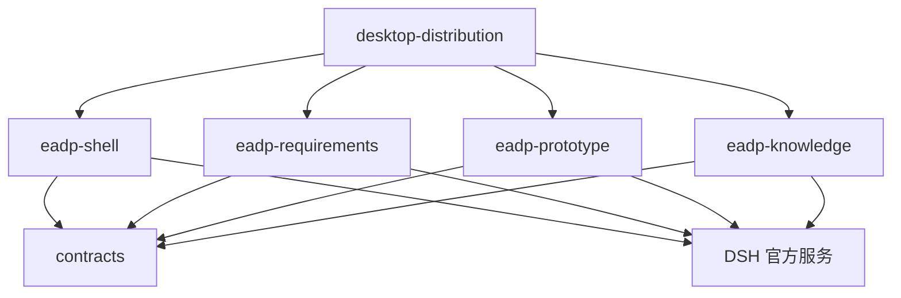

# 总体架构：本地需求与原型工作台

状态：目标设计，尚未实施。证据与宿主接口见 [evidence.md](evidence.md)；用户流程见 [user-flows.md](user-flows.md)；写入与运行边界见 [permissions-runtime.md](permissions-runtime.md)；实施切片见 [implementation.md](implementation.md)。

## 1. 目标与边界

把 EADP 从协同资产工作台改为单机工作台：项目是用户选定的普通文件夹，需求是可直接编辑的 Markdown，原型是项目里的普通代码工程；AI 读取需求、提出修改，用户审阅后应用；AI 修改原型，用户在系统浏览器运行和操作；知识库由随包内置只读卡和用户可维护的本机知识卡组成。会话、模型、授权、设置、审批继续由 DSH 提供，产品不另建 Agent、模型注册或权限系统。

不保留：场景、材料确认状态、开发认领、协同任务队列、候选集成、基线、交接、复用采用、协同登录、远程后端、应用管理的 Git 流程、内嵌预览画布、自动浏览器验收。不提供旧 API 本地模拟、旧目录双读、数据 migration 或 fallback。

## 2. 包结构

```text
apps/desktop-distribution       固定 DSH、插件装配、发行
packages/eadp-shell             @eadp/shell         项目入口、工作台布局、原生会话承载、会话策略
packages/eadp-requirements      @eadp/requirements  需求文件、编辑保存、AI 提案、CONTEXT.md
packages/eadp-prototype         @eadp/prototype     原型文件、创建、依赖安装、运行、停止、系统浏览器
packages/eadp-knowledge         @eadp/knowledge     内置知识包、用户知识库、搜索/读取、引用工具
packages/contracts              @eadp/contracts     跨包类型、TypeBox 请求、slot/错误合同
```

不新增 project、seats、panel-base、workspace-kit 包。项目身份直接使用 DSH Workspace，不建立第二个项目注册表。contracts 不包含文件系统实现、React 组件、进程或数据库代码。

### 2.1 职责矩阵

| 包 | 负责 | 明确不负责 |
| --- | --- | --- |
| eadp-shell | 项目首页与工作台布局；读取官方 Workspace 列表；创建/打开/重新定位/移除项目；承载原生会话；创建/恢复会话时的 guard 与动态上下文；活动文档登记；应用关闭协调 | 不保存项目注册表；不写需求/原型文件；不实现聊天、模型、设置；不启动原型进程 |
| eadp-requirements | `需求/` 文件树、创建/改名/删除、Markdown 编辑、自动/离场保存、外部改动、AI 提案、CONTEXT.md、需求读取/提案工具 | 不做项目身份；不做原型运行；不做场景/确认/模板/来源门禁 |
| eadp-prototype | `原型/` 文件查看、模板创建、依赖安装、受管运行、停止、日志、系统浏览器 URL | 不做需求存储；不做代码提案/审阅；不做自动验收/发布/Git/画布 |
| eadp-knowledge | 随包只读知识卡、用户本机知识库（新增/修改/删除 Markdown 卡）、AI 知识提案（用户确认写入）、搜索/读取、出处与版本、Agent 工具 | 不做上传平台/联网抓取/向量库/独立 MCP/另一套 Agent；Agent 不能直接写知识；不把知识写成需求 |
| contracts | 跨端数据形状、请求校验、slot 名/属性、错误码、工具名约定 | 不放执行代码、进程、React、业务编排 |
| desktop-distribution | 固定上游、品牌、插件组合、模板/运行时资源、构建与产物校验 | 不放业务状态机；不携带协同后端/浏览器运行时 |

### 2.2 依赖方向与协作



- 功能包之间不导入对方的 `host/application`、`client/components` 或内部 store。跨包只通过 contracts 中的类型、官方 slot、客户端窄服务和 Host 远程命名空间协作。
- Shell 声明 `eadp.requirements.view`、`eadp.prototype.view`、`eadp.knowledge.view` 三个 child slot；requirements/prototype/knowledge 各自注册，不互相 import 组件。知识库 UI（搜索、内置/用户分组、用户卡新增/编辑/删除、AI 提案审阅）由 knowledge 包自己实现；Shell 只提供页签与活动状态。Agent 工具与引用是知识能力的核心，UI 用于用户维护知识卡和确认 AI 提案。
- Shell 客户端在切换项目/关闭前调用 requirements 客户端的 `flushActive()`；该服务由 requirements 注册、接口定义在 contracts。Shell 不读取 requirements 的草稿内部。
- Host 侧各包直接注入 DSH 的 `workspaceRegistry`、`sessions/sessionController`、`fs`、`tools` 等官方服务；不通过 shell 转发。Shell Host 只在会话创建/恢复时注册 guard 与动态上下文。
- 每个包拥有自己的 Typert Remote 命名空间：`eadpShell`、`eadpRequirements`、`eadpPrototype`、`eadpKnowledge`。不使用一个包含所有领域方法的巨型 command。签名变化必须重跑 Typert 生成器。
- 不新建 HTTP 服务。DSH 的本地 Host 仍是运行时的一部分，不把“去协同后端”误读为把文件权限交给 Renderer。

## 3. 项目模型

### 3.1 项目 = DSH Workspace

固定 DSH rc.2 已提供持久 Workspace：`WorkspaceId`（UUID）、`path`（创建时 canonical realpath）、`title`、`sessionIds`、`createdAt/updatedAt`。项目身份、真实目录和会话归属因此有唯一权威，不再在项目文件夹写第二份身份。

```text
<Workspace.path>/                 用户选定的普通文件夹，即项目根
  CONTEXT.md                      可选，项目背景
  需求/                            首次创建需求时生成；可含子目录
    登录.md
    用户管理.md
  原型/                            用户创建原型工程时从模板复制；普通代码工程
    package.json
    src/
    public/
```

- 不创建 `.eadp/`、`project.json`、`owner.json` 或任何项目身份标记。项目名用 `Workspace.title`，可经官方 rename 修改。
- 不保留旧默认项目位置 `~/EADP` 偏好；新建/打开使用官方目录选择与创建。程序数据仍在 DSH `DSH_HOME`，不与项目文件混放。
- 不预建空目录。首次创建需求时创建 `需求/`；用户点击“创建原型工程”时才创建 `原型/`。
- 普通外部文件夹只要用户选定并登记为 Workspace，就可以打开；应用只展示 `需求/`、`原型/`、`CONTEXT.md` 的实际内容，不自动移动、覆盖或清理其他文件。
- 旧 EADP 项目的 `repo/`、`场景/`、`交接/`、`原型代码/` 不做兼容读取；用户需要保留时手工整理为 `需求/*.md` 与 `原型/`。应用不开发导入器或 migration。

### 3.2 权威状态

| 数据 | 唯一权威 | 不做的事 |
| --- | --- | --- |
| 项目身份、名称、真实目录、会话归属 | DSH Workspace registry | 不在文件夹写 projectId；不自建项目表 |
| 需求、CONTEXT.md、原型源码 | 项目普通文件 | 不复制正文到 SQLite/内存当第二真相 |
| 原生会话、消息、模型选择、凭据、审批 | DSH | 不自建 Chat、模型注册或审批 |
| 活动文档、布局偏好 | Shell 本地 UI 状态（按 workspaceId） | 不保存业务阶段，不作为写入授权 |
| 运行中的进程、端口、URL | prototype Host 的实际进程表 | 不从上次 `running` 字段恢复；不按端口接管未知进程 |
| 内置知识卡与版本 | 随包只读资源 | Agent 不能改写；知识不是项目事实 |
| 用户知识卡与版本 | 本机应用数据目录中的用户知识库；用户是内容作者 | Agent 不能直接写；不写入项目文件夹；不属于项目正文 |
| AI 知识提案 | knowledge Host 内存 | 不是知识真相；用户确认前不落盘；重启丢失，可重新生成 |
| AI 提案 | requirements Host 内存 | 不作为文件真相；重启后丢弃，可重新生成 |

### 3.3 身份、目录与会话授权

| 情况 | 行为 |
| --- | --- |
| 新建项目 | 用户选定父目录并创建子目录（官方目录选择/创建），`workspaces.create(path)` 登记；不预建 `需求/`/`原型/`；返回 Workspace 并打开 |
| 打开已有项目 | `workspaces.create(path)` 幂等：canonical path 已登记则复用；否则登记新 Workspace。随后读取实际目录，显示空状态或内容 |
| 同一目录的别名 | `realpathNormalize` 解析大小写、`..`、符号链接；同一 canonical path 复用同一 Workspace，不重复登记 |
| 复制目录 | 新路径 → 新 Workspace、新 WorkspaceId；两份项目各自独立，会话/进程/提案不串用；不存在重复 ID 冲突 |
| 重复 projectId | 目标设计不存在：WorkspaceId 由 registry 生成，文件夹不携带 ID；只有 registry 能产生身份 |
| 目录搬移 | 旧路径打开失败（ENOENT）→ 用户选择新路径 → `workspaces.create(newPath)` 创建新 Workspace → 成功后 `workspaces.delete(oldId)` 删除旧登记。旧会话仍按旧 cwd 存在于 DSH 存储，不能迁移到新 Workspace；新项目使用新会话 |
| 目录仍存在但被替换 | 按新目录重新打开；旧 Workspace 的 path 仍是旧 canonical 路径；若旧路径仍可访问且指向不同内容，用户看到的是旧登记路径，需明确重新定位/移除，不能静默改 path |
| 从最近移除 | 先停止该项目自有原型进程；有活动 AI 轮次时先取消/等待或拒绝移除并说明；`workspaces.delete` 只删登记，不删文件/会话；移除后旧请求因 workspaceId 不存在被拒绝 |
| registry/profile 丢失 | 重新打开文件夹会创建新 Workspace；文件内容不丢；旧会话历史仍在 DSH 存储但不再分组。应用不伪造旧历史 |
| 会话创建 | 用官方 `SessionCreateRequest({workspaceId, agentPreset})` 或 `agents.create(meta.cwd=workspace.path, agentPreset)` + `workspace.attachSession`；session cwd 的 realpath 必须等于 workspace.path |
| 会话恢复 | 从 `Workspace.sessionIds` + `sessionQuery.filterSessions([{kind:'cwd',values:[path]}])` 列出；`agents.resume({resumeSessionId, setup})`；setup/guard 必须重新注册；cwd 不匹配新 Workspace 的旧会话不提供恢复 |
| 迟到请求 | 每个请求携带 workspaceId；Host 每次重新 `workspaceRegistry.get` 并核对真实路径；workspace 已删除/搬移则拒绝。客户端按 workspaceId + 选择 epoch 丢弃旧回包，不重定向到新项目 |
| 无项目会话 | 未绑定 Workspace 的原生会话仍可聊天，但 guard 拒绝文件工具；不把全局会话当作项目写入通道 |

**限制（必须如实呈现）**：Workspace.path 创建后不可变，DSH 没有跨 Workspace 搬迁会话的接口。目录搬移的“重新定位”是新建登记并删除旧登记，不是同一 WorkspaceId 的路径更新；旧 AI 会话历史不会随目录搬移。该限制登记在 [evidence.md](evidence.md) 与仓库缺口清单（当前 `docs/blocked-upstream.md` 缺失，见 README 第 6 节），不通过自建注册表绕过。

## 4. 保存与 AI 修改

### 4.1 文件写入

所有需求/CONTEXT/原型文件操作都以项目根为边界：

- Host 用 `ctx.fs.resolve(path,{cwd:workspace.path})` 得到真实 target，再用 `ctx.fs.contains(root,target)` 校验包含关系；拒绝绝对路径、`..`、链接逃逸、`.git` 与敏感文件。
- 读取用 `ctx.fs.stat` + `readText`；`FsVersion` 是不透明版本，客户端只保存、比较是否变化，不解释其内容。
- 用户保存用 `ctx.fs.writeText(target,text,{kind:'replaceIfVersion',version})`；新建用 `createIfAbsent`；版本不符返回 `FS_STALE_VERSION`，保留用户输入。
- Host 调用 `ctx.fs` 时显式传入 `{mode:'workspace-write', workspaceRoot:workspace.path}`，由 fs-sandbox 执行项目边界；不修改全局 sandbox 默认值。
- `ctx.fs` 没有目录/重命名/删除抽象；这些用户操作由 Host 在 `resolve`+`contains` 后用 Node fs 完成，并在操作前后核对真实路径。它们不受 `replaceIfVersion` 保护，不能声称与外部进程原子。

### 4.2 编辑器与草稿

- 编辑器内存是“未保存输入”的权威；磁盘文件是“已保存内容”的权威。保存成功才更新已保存版本。
- 自动保存按文件串行，同一文件的旧请求回包不能覆盖新输入；中文 IME 组字期间暂停自动保存，离场等待组字结束。
- 外部改动通过 `ctx.fs.watch`/`stat` 检测：干净文档可刷新；脏文档保留草稿并展示差异，由用户选择载入磁盘或保留输入，不静默覆盖。
- 正常关闭/切换项目前调用 requirements 的 `flushActive()`；失败、组字中或仍有脏草稿时留在原处并说明。强杀进程可能丢失最后未保存输入，本文不承诺崩溃级草稿恢复。

### 4.3 AI 提案

- 需求与 CONTEXT 的 AI 修改只能通过 `eadp_requirement_propose` 工具生成提案；需求会话的 `tool-fs` 在预设层关闭 `write/edit`，guard 再拒绝写入。AI 不能借原型工具或 shell 改需求。
- 提案是单文件整篇候选：绑定 workspaceId、相对路径、读取版本 `baseVersion`、候选正文、摘要。Host 生成行级差异；用户审阅后显式应用。
- 应用顺序：客户端暂停自动保存 → 等待在途保存 → 核对组字/脏草稿/活动项目 → 主机重新 `stat` 版本 → `replaceIfVersion` 写入 → 返回实际版本与正文 → 客户端更新已保存基准并恢复自动保存。任一核对失败都保留草稿和提案。
- 用户批准不等于版本核对：版本变化必须返回过时，不能把旧提案覆盖到新内容；不自动合并、不静默重算。
- 提案只在 Host 内存；重启后丢弃。聊天历史仍在 DSH，用户可让 AI 重新读取并生成。
- 详细协议、竞态与失败行为见 [packages/eadp-requirements.md](packages/eadp-requirements.md)。

### 4.4 外部进程竞态

`ctx.fs` 的每目标锁和 `replaceIfVersion` 能串行本应用内的读取/保存/提案，并在写入前检查版本；它不是对任意外部编辑器的 OS 级条件写。外部进程在“检查版本后、rename 前”写入的窗口无法由应用内队列消除。本文只承诺：检查到变化就拒绝覆盖；检查后仍未变化时执行原子替换；不声称跨外部进程的绝对安全。

## 5. 权限与原型运行

### 5.1 分层

| 层 | 作用 | 边界 |
| --- | --- | --- |
| Agent preset | 需求预设注册只读 fs；原型预设注册 write/edit；不挂 shell | 预设是能力面，不是唯一防线 |
| Tool guard | 按真实 session cwd 绑定 Workspace；工具名白名单；读写路径白名单；拒绝无项目/子 Agent 越界 | 单调拒绝，不能改写参数；不能替代 OS 沙箱 |
| fs-sandbox | `workspace-write` 把写限制在 session cwd（项目根） | 读全部放行；不细分到 `原型/` |
| Host 服务 | 用户发起的保存/创建/运行；`ctx.fs` 版本写与 containment | Host 是受信代码；不把用户点击暴露为免授权工具 |
| 原型子进程 | 用户授权的项目代码执行 | `ctx.subprocess` 无沙箱；不能声称受 DSH 限制 |

- 原型会话的 write/edit 允许，但 guard 把可写范围限定在 `原型/`，并保护 `node_modules/`、`.git/`、`.umi*/`、`dist/` 等；需求/CONTEXT/其他项目写入被拒。
- 需求会话完全没有 write/edit；提案工具只写 Host 提案记录，不写项目文件。
- 知识提案工具 `eadp_knowledge_propose` 只写 Host 提案内存；用户确认后由 knowledge Host 写用户知识库；内置知识包无写接口，Agent 不能直接写。
- shell/pwsh、`run_code`、MCP/第三方插件工具、`spawn_agent` 默认拒绝；需求/原型运行与依赖安装由用户点击 Host 操作，不作为 Agent 工具。
- 详细通道矩阵与反向验收见 [permissions-runtime.md](permissions-runtime.md)。

### 5.2 原型运行

用户创建/打开项目 → 打开原型页 → 需要时点击“安装依赖” → 点击“运行” → Host 用固定 Node/pnpm 在 `原型/` 执行 `pnpm run start` → 选端口、等待真实 HTTP 就绪 → 返回 loopback URL → 客户端用系统浏览器打开 → 用户操作 → 点击“停止”或退出应用时结束本应用启动的进程树。运行失败保留日志与实际原因，不伪造成功。细节见 [packages/eadp-prototype.md](packages/eadp-prototype.md)。

## 6. 知识链路

知识分两层：

- **内置知识包**：随应用发行、只读、版本化。少量人工整理的 Markdown 卡 + `SOURCES.md`，记录出处、适用范围、知识资产版本；不依赖用户机器上的 skill/插件。
- **用户知识库**：本机应用数据目录中的用户 Markdown 卡。用户通过知识库页签新增/修改/删除，填写标题、出处、适用范围、标签；Host 维护 manifest、hash 与版本。AI 可以读取并**提议**新增/修改用户知识卡，但提案只存 Host 内存；用户在知识库页签确认后，Host 重新核对版本并写入。内置知识包只读，AI 不能提议修改内置卡；需要适配时新建用户卡。

Agent 调用 `eadp_knowledge_search` → 得到有限命中与 `packId/packVersion/documentId/title/excerpt/source/scope/sha256` → 需要时 `eadp_knowledge_read` 按卡片读取（offset/length 续读）→ 在回答中带出处与版本。需要补充/修改知识时调用 `eadp_knowledge_propose` 生成提案；用户审阅差异并确认后，`applyKnowledgeProposal` 才写用户知识库。知识是数据，不是系统指令；正文中的命令不能绕过执行授权。未命中与包损坏是不同结果；内置包损坏报安装资源问题，用户知识库损坏报具体卡片/清单问题；两者都不阻断需求编辑与原型运行。内置初始卡片内容仍需团队确认，但用户可自行补充、AI 可提议，不再把“完整业务文档集未提供”作为阻塞。

## 7. Editor 借鉴与禁止项

采用其机制：Workspace 即项目、canonical 路径、版本条件写入、离场保存顺序、会话内重解析范围、显式扩展合同。具体证据见 [evidence.md](evidence.md) 第 4 节。

禁止照搬：

- Editor 绑定 DSH 0.2.1-rc.5 和 3 个 rc.5 补丁；EADP 固定 rc.2，不为复用组件升级宿主。
- Editor 的 `/manuscript`、`/dsh-editor-workbench` 私有 RPC；EADP 用官方 Typert Remote。
- Editor 的 root 遮蔽 AppFrame；EADP 用官方 `main`/`sidebar`/conversation slot，不抢占根座位。
- Editor 的小说、人物卡、作者侧写、稿纸品牌与写作确认业务。

## 8. 失败与错误原则

- 失败必须显示实际原因与可执行的下一步；不把失败包装成空状态、假成功或“稍后自动恢复”。
- 部分写入只在真实发生且已核对时报告；单文件提案不制造“部分成功”语义。运行进程只结束本应用启动的进程树。
- 外部删除/损坏的项目、文件、知识包如实报告；不自动重建、不静默清空、不删除最近记录中的唯一线索。
- 删除旧实现前先保护唯一未提交成果与活动任务；删除代码不等于删除用户文件或 DSH 历史。
- 构建成功、类型检查通过不等于桌面验收通过；未验证能力必须在交付说明中列出。

## 9. 开放项

1. 内置知识包的初始卡片内容/出处需团队确认；用户可自行新增/修改，因此不再阻塞切片 5 的机制与用户知识库验收。
2. Workspace 服务在 EADP profile 的实际装载、resume 时 guard 注册、`window.open` 外部打开、Umi 端口/就绪、Windows 进程树停止需在真实桌面核实（见 [evidence.md](evidence.md) 6.2）。
3. 目录搬移不迁移旧会话历史，是固定宿主限制；若业务要求可迁移项目 ID/历史，需要新的产品决定与上游接口。
4. 生产门槛仍写在仓库 `AGENTS.md` 的旧“场景→需求→原型→基线→交接”链路中；实施切片 6 时必须同步替换为本地闭环门槛，不能沿用旧链路宣称生产就绪。
