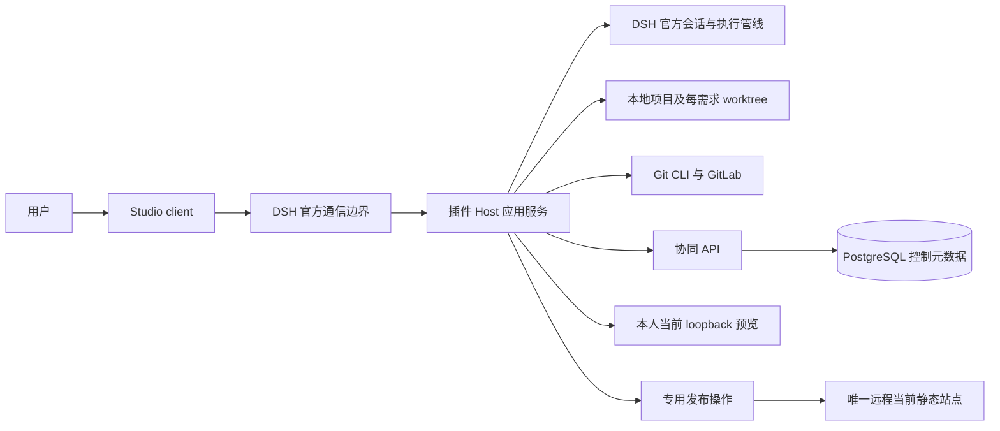

# 6. 代码架构

> 设计日期：2026-10-14。依据 [01-项目定位.md](01-项目定位.md)、[02-项目架构.md](02-项目架构.md)、[05-产品形态与主界面.md](05-产品形态与主界面.md) 与 [CONTEXT.md](../CONTEXT.md)。开发环境为 Linux，桌面测试环境为 Windows。本文确定代码组织、职责和依赖方向；目录、类型与函数名是实现设计，不表示代码已存在或目标 DSH 接口已验证。环境与验收安排见 [07-开发与测试环境.md](07-开发与测试环境.md)。

## 6.1 架构结论与成熟模式

采用 **TypeScript + pnpm workspace 的 monorepo**，向用户交付一个可安装的 eadp 项目工作台桌面客户端，向企业运维交付一个集中部署的协同 API。桌面客户端基于固定官方 DSH 桌面源码构建定制发行，内置并默认启用工作台 Host/client 插件、指定模板及所需工具链。插件包是内部构建件，不是要求用户另行安装的交付物；用户不必预先下载 DSH。插件内部划分 client、Host 应用服务与外部能力接入；后端采用模块化单体，由 PostgreSQL 承担控制元数据的事务与持久化。

这是本次代码架构的技术选择。原规划尚未选择后端框架和数据库；本文选择 Fastify 与 PostgreSQL，是为了以同一语言维护边界契约，用标准 HTTP schema 校验和数据库事务落实既定协同行为，不增加跨服务事务。企业数据库、认证入口及运行时是否满足要求由 G0 验证；不满足时重新作架构决策，不在代码中增加备用数据库、框架切换或兼容路径。

| 已验证的通用模式 | 本项目采用方式 | 证据与适用限制 |
| --- | --- | --- |
| DSH 官方 Host/client 插件 | 一个插件包提供 Host 与 `./client` 两个入口，client 注册 Studio 主界面 | [官方 client modules](https://github.com/deepseek-ai/deepseek-harness/blob/master/packages/client/modules/README.md) 与 [ui-layout](https://github.com/deepseek-ai/deepseek-harness/blob/master/packages/client/ui-layout/README.md)；上游文档说明模式，目标 Windows 发布版仍需 G0-1 验证 |
| DSH 完整桌面发行 | 复用官方 Electron 构建与安装管线，构建内置工作台的单一 Windows 安装包，桌面与内置组件整体验收和更新 | [官方 desktop README](https://github.com/deepseek-ai/deepseek-harness/blob/master/apps/desktop/README.md)；2026-10-14 核对其完整依赖与整体更新模式，定制发行与目标版本仍需实测 |
| 官方扩展承载会话及工具控制 | 宿主能力只从 `host/adapters/dsh/` 接入；业务模块调用自己的有限能力接口 | [extension cookbook](https://github.com/deepseek-ai/deepseek-harness/blob/master/docs/cookbook/extension-cookbook.md)；不复制 Agent loop，也不把示例 API 当作发布版保证 |
| HTTP schema 与显式事务 | Fastify 校验请求/响应结构，应用服务进行授权与业务校验；PostgreSQL 约束、短事务和条件更新保证协同一致性 | [Fastify validation](https://fastify.dev/docs/latest/Reference/Validation-and-Serialization/)、[PostgreSQL locking](https://www.postgresql.org/docs/current/explicit-locking.html)；结构检查不能代替业务规则、可信身份或真实并发实测 |
| docs-as-code 与固定版本 | Git 保存材料和来源，Host 固定并复核实际字节，后端关联固定引用 | 02 §2.3、§2.7.4；Git 与数据库不组成一个原子事务 |
| 平台差异集中在执行边界 | 同一业务代码在 Linux 开发与 Windows 测试，路径、可执行文件、进程树和凭证能力分别验证 | [Node child_process](https://nodejs.org/api/child_process.html)；尤其不能直接把 Unix 命令和信号语义搬到 Windows |

首期不拆微服务，不引入消息中间件、分布式缓存、通用流程引擎或通用 provider/模板平台。后台清单任务运行在桌面 Host；后端不运行 Agent。过时契约和实现直接删除，不保留旧入口、migration 或 fallback。

## 6.2 工程与运行边界

工作台研发仓库与用户的过程资产仓库是不同工程：前者维护插件、API、契约和随包模板；后者保存业务材料与生成的原型。用户项目里的原型工程不能被打包为高权限插件代码。



图中的通信边界表示调用关系，不指定未验证的 DSH RPC 名称。client 经宿主已验证通信调用 Host，Host 经固定企业服务地址访问 API；client 不直接持有后端登录令牌、PAT、发布密钥或 shell 能力。

| 代码交付物 | 运行位置 | 拥有的能力 |
| --- | --- | --- |
| `desktop-distribution` | Windows 上安装的 eadp 项目工作台 | 固定 DSH 桌面、内置插件/模板/运行时的发行装配，单一安装、启动、升级与卸载入口 |
| `studio-plugin` Host | 官方 DSH Host 执行环境 | 资产读写、任务绑定、受控 Git/进程、协同调用、预览与专用发布 |
| `studio-plugin` client | 官方 DSH 桌面客户端的浏览器执行环境 | 五阶段视图、官方 Agent 交互入口、可信用户操作、状态与错误呈现 |
| `collaboration-api` | 企业集中服务；按 Linux 服务组织部署 | 既有身份认证、授权、目录/状态、持久占用、确认、场景批次、集成操作、资格与采用控制 |
| 随包原型模板 | 插件发布资产；运行时复制到用户项目 `原型代码/` | 规定该原型的运行时、依赖、规则、检查、预览、Mock 和静态构建 |

Linux 是本项目开发环境；Windows 是桌面产品打包、签名和原生测试环境。本设计复用并构建官方 DSH Electron 桌面发行，增加必要的产品装配，不另写桌面壳、启动器或更新器。Linux 构建通用代码与插件资产，Windows 生成并验收最终安装包；不承诺 Linux 交叉构建 Windows 安装包或 Linux 桌面产品支持。后端的 Linux 部署是本设计安排，不是已经存在的企业基础设施证据。

## 6.3 研发仓库目录

以下为目标目录。当前仓库沿用 `CONTEXT.md`、`docs/adr/` 和规划文档，已建立单仓库开发配置、随包模板快照及固定 DSH 归档获取入口。下述业务模块仍按任务逐项实现，不预建空模块或伪实现；实际准备情况见 [开发交接](../docs/development/handoffs/repository-setup.md)。

```text
eadp-e2e/
├─ packages/
│  ├─ studio-plugin/                  # 一个 DSH 插件发布包
│  │  ├─ src/
│  │  │  ├─ host/
│  │  │  │  ├─ index.ts               # 官方 Host 插件入口与生命周期
│  │  │  │  ├─ composition.ts         # 构造应用服务、绑定真实能力
│  │  │  │  ├─ application/
│  │  │  │  │  ├─ projects/           # 新建、打开、发现与恢复
│  │  │  │  │  ├─ materials/          # 场景/需求确认、联动修订
│  │  │  │  │  ├─ tasks/              # 会话绑定、阶段驱动、反向修订
│  │  │  │  │  ├─ integration/        # 受理、候选、条件更新与核对
│  │  │  │  │  ├─ handoffs/           # 基线后清单生成、确认、收悉
│  │  │  │  │  └─ reuse/              # 固定包读取、采用和目标确认
│  │  │  │  ├─ prototype/             # 原型专属生产能力
│  │  │  │  │  ├─ template.ts
│  │  │  │  │  ├─ generation.ts
│  │  │  │  │  ├─ checks.ts
│  │  │  │  │  ├─ preview.ts
│  │  │  │  │  └─ publication.ts
│  │  │  │  ├─ ports/                 # 已有外部职责所需最小能力接口
│  │  │  │  └─ adapters/
│  │  │  │     ├─ dsh/                # 目标宿主版本的实际接入
│  │  │  │     ├─ assets/             # MD/清单读写、快照和 hash
│  │  │  │     ├─ workspace/          # 本地 Git CLI、worktree、快照
│  │  │  │     ├─ gitlab/             # 项目/分支权限和可选 MR
│  │  │  │     ├─ collaboration/      # HTTP 调用与结果核对
│  │  │  │     ├─ local-state/        # 最小任务/操作现场的原子落盘
│  │  │  │     ├─ platform/           # 路径、进程、工具、凭证边界
│  │  │  │     └─ publication/        # SSH/SFTP 与目标发布原语
│  │  │  └─ client/
│  │  │     ├─ index.ts               # 官方 client 插件入口
│  │  │     ├─ studio/                # 满窗布局、项目入口、标题栏
│  │  │     ├─ features/
│  │  │     │  ├─ scenarios/
│  │  │     │  ├─ requirements/
│  │  │     │  ├─ prototype/
│  │  │     │  ├─ baselines/
│  │  │     │  └─ handoffs/
│  │  │     ├─ components/            # 材料、问题、差异、资格、错误
│  │  │     ├─ bridge/                # 官方通信与会话 UI 接入
│  │  │     └─ state/                 # 页面选择与 Host 状态投影
│  │  ├─ assets/prototype-template/   # 实际指定模板及其 AGENT.md
│  │  ├─ assets/prototype-template.manifest.json # 来源版本和文件哈希；当前尚未通过模板验收
│  │  ├─ build/                       # Host/client 构建与模板打包
│  │  └─ package.json
│  ├─ asset-domain/
│  │  └─ src/                         # 领域类型、关系/前置检查、规则
│  └─ contracts/
│     └─ src/
│        ├─ files/                    # 项目清单、固定包/基线结构
│        ├─ host-client/              # 操作、状态投影、错误结构
│        └─ collaboration/            # API 请求/响应 schema
├─ apps/
│  ├─ desktop-distribution/           # eadp 桌面产品发行，非新写 Electron 壳
│  │  ├─ release.lock.json            # DSH commit、插件/模板/工具链固定组合
│  │  ├─ resources/                  # 产品名称、图标、许可与第三方说明
│  │  ├─ build/                      # 固定上游取源码、装配内置 bundle 与打包
│  │  │  └─ patches/                 # 有实际发行改动时加入可审查补丁
│  │  └─ tests/                      # 安装、首次启动、升级与卸载验收
│  └─ collaboration-api/
│     ├─ src/
│     │  ├─ bootstrap.ts             # Fastify 与模块装配
│     │  ├─ auth/                    # 既有身份验证与授权入口
│     │  ├─ gitlab-content.ts         # 按操作者授权临时读取固定 MD，仅内存校验
│     │  ├─ modules/
│     │  │  ├─ projects/             # 可见目录、项目分类
│     │  │  ├─ occupations/          # 领取、取消、管理员释放
│     │  │  ├─ confirmations/        # 固定材料确认与受理事件
│     │  │  ├─ dependencies/         # 版本/范围及完成门禁
│     │  │  ├─ scenario-batches/     # 关联集合、冻结和批次接受
│     │  │  ├─ integration/          # 认可头、操作、完成/核对
│     │  │  ├─ reuse/                # 资格、采用和成功依据
│     │  │  └─ handoffs/             # 固定交接引用与接收状态
│     │  └─ persistence/             # pg 连接、短事务、参数化 SQL
│     ├─ db/schema.sql               # 当前唯一建库定义，不维护迁移链
│     └─ deploy/                     # 企业服务部署与运行检查
├─ scripts/                          # .mjs 开发检查、打包、证据采集
├─ tests/
│  ├─ fixtures/                      # 合成材料、固定仓库与异常样例
│  ├─ contracts/
│  ├─ host-integration/
│  ├─ backend-integration/
│  ├─ platform/
│  ├─ windows-desktop/
│  ├─ e2e/
│  └─ publication/
├─ docs/adr/
├─ docs/development/                  # 两工作站准备与开发交接
├─ dsh_eadp_studio_plan/
├─ CONTEXT.md
├─ package.json
├─ pnpm-workspace.yaml
├─ pnpm-lock.yaml
├─ tsconfig.base.json
├─ .editorconfig
├─ .gitattributes
├─ .gitignore
└─ .local/upstream/dsh/               # 完整获取后生成的本机上游副本，不提交
```

后端各业务模块默认包含 `routes.ts`、`service.ts` 与必要的 `repository.ts`。route 只负责结构校验、取得身份、调用服务和映射响应；service 组织授权、规则与事务；repository 执行参数化 SQL。跨模块事务由负责该业务动作的应用服务统一组织，同一次动作使用同一个事务连接，不让各 repository 自行提交。

`ports/` 只为宿主会话、Git、固定材料存取、协同调用、进程执行和发布等真实边界定义接口，不为每个函数增设 interface/factory。平台实现留在插件内部，不提前发布通用运行时包。

### 6.3.1 桌面发行工程

`apps/desktop-distribution` 是最终用户交付入口，负责把固定 DSH 桌面源码、已构建工作台插件、随包模板和工具链装配成一个安装包。DSH 源码按不可变 commit 在构建工作区取得并核对，不跟随 `master` 自动升级；上游不是用户安装前置条件。复用目标版本已有 Electron/electron-builder 管线，业务功能仍在插件，不复制维护另一套 Electron 主进程、Host 启动或会话实现。

发行所需改动限定为产品标识/资源、内置依赖与默认 bundle、默认打开 Studio、专属数据 profile 和产品更新来源；改动以可审查的构建补丁维护并针对固定上游版本验证。工作台 Host/client 在应用封装前进入完整生产依赖图并默认激活，首次启动不联网执行插件 `add`、不打开插件商店、不让用户启用插件。缺少内置插件或模板直接使发行构建/启动检查失败，不能打开裸 DSH 作为成功结果。

`release.lock.json` 记录工作台产品版本、DSH 源码/运行时版本、插件版本、模板与规则校验值、目标 OS/CPU、发行所需运行时/Git 版本及校验值。用户只看到工作台产品版本，维护者可查完整组件清单；不存在供用户分别更新 DSH 和内置工作台插件的路径。发行使用独立应用标识、安装目录和数据 profile，不依赖或修改用户已有官方 DSH 安装、命令注册或协议关联；Windows 验收同时覆盖干净机与已有 DSH 的共存机器。

Node/pnpm 优先复用固定 DSH 发行已验证的随包能力；Git 和实际模板另需的运行时纳入发行依赖清单并随包提供。工具由 Host 按受管理的绝对路径定位，不依赖用户 PATH，也不要求用户手动安装开发环境。模板依赖仍按锁文件由 Host 自动安装，依赖源/代理/证书由维护者提供，不把 npm 命令交给用户。只有发行依赖和执行隔离实测通过才开放原型能力。

Windows 最终交付为单一签名安装程序（目标采用官方 electron-builder 的 NSIS `.exe` 发行管线，实际构建能力在 G0 固定）。构建产物包含本产品、固定 DSH、内置插件、模板和运行时，不包含用户账号/发布凭证；保留 [DSH LICENSE](https://github.com/deepseek-ai/deepseek-harness/blob/master/LICENSE) 及各捆绑依赖要求的第三方说明。签名凭证仅在受控发行环境取用，不进入桌面包。

安装包和更新包使用本产品的受信发行渠道。复用官方成熟更新机制，但配置并验证本产品的来源、版本、签名和整组装配，不接收上游 DSH 的独立升级覆盖工作台组合；目标版本不支持所需接入时，完成并验证明确的发行改动，不能退回用户分步安装。更新在受控停止本地执行并保护未保存/在途现场后替换完整应用，既有后端占用不因更新释放；卸载移除应用文件，保留用户项目、正式资产与恢复现场，不以卸载清理业务数据。

## 6.4 技术栈与构建约束

| 层 | 代码架构选择 | 固定与验证方式 |
| --- | --- | --- |
| 研发 workspace | TypeScript strict、pnpm workspace、单一工作台锁文件 | 开发准入为 Node `>=22`、pnpm `11.x`，不限制补丁版本；G0 记录实际 Node/pnpm/TypeScript 版本；按锁文件冻结安装 |
| 桌面发行 | 固定 DSH Electron 桌面源码及官方打包/更新机制，内置工作台 bundle | `desktop-distribution` 装配；Windows 原生打包、签名、干净机安装/升级/卸载实测；最终交付为桌面安装包 |
| Studio client | React，复用目标 DSH 的共享 UI/React 能力；按官方 client bundle 约定构建 | 上游 client modules 有 React 平台模块；实际 externals、构建 preset、CJS/ESM 边界在目标版验证，不打包另一套宿主框架 |
| 插件 Host | TypeScript、官方 DSH/Cordis 生命周期、Node 标准能力 | DSH 依赖精确固定到被验收版本；具体 SDK imports 只在 dsh adapter；不照搬后端输出格式到插件 |
| 协同 API | TypeScript、Fastify、PostgreSQL、`pg` 参数化 SQL | schema/授权/事务分层；PostgreSQL 主版本及 Node 版本在企业环境冻结；不用 ORM 隐藏条件更新与锁范围 |
| 契约 | JSON Schema 与对应 TypeScript 类型 | 采用单一 schema 来源生成/推导类型，检查生成一致性；不并行手写两套 DTO；只接收代码内维护的 schema |
| 验证 | Vitest 规则与集成测试，Playwright 浏览器行为检查，Windows 官方桌面实测 | 浏览器测试不替代桌面测试；具体宿主自动化入口先做 G0 验证 |
| 原型模板 | 实际指定模板决定该原型的框架、运行时、包管理器和 Mock | 已指定 `sei-blank-ts-app-2.0` 候选，静态核对为 React 18 / TypeScript / Umi；冻结依赖、规则、检查和纯静态 Mock 验证待完成，见 [G0-3](G0-3-模板契约与规则加载.md)。模板自身锁文件与工作台锁文件独立，不将该 Umi 模板约束扩展为工作台栈 |

构建与发行验收实际使用的精确版本必须进入发布基线；工作台开发的 Node `>=22`、pnpm `11.x` 准入范围不替代这些证据，也不改变固定 DSH 上游和模板各自的工具契约。不能因为 Linux 有可用的系统 Node 就假定 Windows 宿主版本满足要求。工作台构建工具与模板工具链分别核验。模板不作为 workspace 子包参与工作台依赖安装，打包时仅复制经清单校验的源文件；不携带 `node_modules`、构建产物、`.git` 或凭证。

API schema 对未知字段直接拒绝，不静默丢弃请求字段：对象 schema 设置 `additionalProperties: false`，Fastify/Ajv 禁止自动移除未知字段；契约测试提交额外字段必须得到拒绝。尤其确认请求不能携带 `body`、`prompt`、`conversation`、`toolLogs` 等正文/过程字段；错误与日志也只记录允许的控制字段。版本不支持时明确拒绝，不解析旧清单或转换旧 API。`schema.sql` 不能被当成可在已有正式数据上重建或清库的自动操作，正式资产及元数据仍长期保留。

## 6.5 依赖方向与代码所有权

```text
contracts                              # 格式和传输结构，无 IO
asset-domain                           # 纯领域规则，无 IO

Studio client ───────────→ contracts    # 不导入 Host 或 backend
Host application ────────→ asset-domain / contracts / Host ports
Host adapters ──────────→ Host ports / 各自真实 SDK 与库
API service ────────────→ asset-domain / contracts / persistence / GitLab content adapter
API routes ─────────────→ contracts / auth / API service
```

`asset-domain` 管资产身份、固定版本、材料内容标准、关系和前置图等纯规则，不访问文件、数据库、HTTP、DSH 或模型。后端仍是协同决策权威；共享规则只是避免结构/关系判断漂移，不使 client 或 Host 获得占用、资格或完成状态的决定权。

`contracts` 定义传输和文件结构，不承载权限判断、流程编排或凭证。Host 和 API 不互相 import 实现；client 只消费经过裁剪的 Host 状态投影。构建检查拒绝 client 引用 `node:*`、Host、`pg`、SSH 或凭证模块，拒绝 domain 引用 IO 库。

只在 `composition.ts` 与 `bootstrap.ts` 完成具体能力装配。场景、需求和交接使用公共材料/关系能力；原型运行、构建、Mock 与发布保持在 `prototype/`，不让所有资产强制经过原型检查。未来概要/详细设计当前只预留资产类型和关系，不创建空工具或预先设计通用生产模块框架。

`desktop-distribution` 只在构建时依赖插件构建产物和固定 DSH 发行输入，不包含业务规则；插件与协同 API 不反向依赖发行工程。桌面发行锁定用户端完整组合，企业 API 仍独立部署；配套 API 契约必须通过发行验收，版本不匹配明确阻断，不增加旧 API 兼容层。

## 6.6 用户项目与本地现场

用户项目仍严格保持三业务目录：

```text
用户过程资产仓库/
├─ 场景/<scenario-id>.md
├─ 需求/<requirement-id>.md
├─ 原型代码/                           # 完整指定模板、根 AGENT.md
├─ project.assets.json                 # 本设计命名：身份、分类、版本与关系
├─ baseline.<baseline-id>.json          # 本设计命名：固定资产集合及依据
└─ handoff.<handoff-id>.md              # 本设计命名：可阅读交接正文
```

根文件名在 G0 样例中验证并固化，不增加第四个业务目录。标题在正文与清单中保存，不能替代稳定 ID。MD 保存规则、来源、反馈、限制与确认依据；清单引用固定版本，不自动指向最新。清单引用已有源提交，基线标记再指向清单提交，避免记录包含自身的提交 SHA。

官方会话继续由 DSH 管理。插件本地状态使用目标宿主提供并经 G0 验证的存储位置，放在 Git 仓库外；持久化 task binding、确认快照索引、待同步 operation 与预览/发布核对记录，不复制完整官方会话。

每需求 worktree 保持相同项目结构，绑定认可 base SHA、固定输入与前置完成依据。同一 worktree 只允许一个本地写入任务；本地互斥不代替后端占用。发布使用独立干净快照，不复用工作树构建产物。本地临时清理先检查未提交/未推送、在途操作和唯一恢复证据；正式 Git 可达引用与后端证据永久保留，资格停用不触发删除。

## 6.7 类型、状态与接口设计

### 6.7.1 状态分别建模

以下状态标签用于实现设计；在 G0 固定编码后进入唯一契约。

| 状态对象 | 表达内容 | 权威 |
| --- | --- | --- |
| 材料候选 | 草稿、检查阻断、固定待推送、已推送待同步 | Host 本地；不得冒充确认 |
| 内容确认 | 固定材料版本及被接受的确认事件 | 后端；正文从 Git 读取 |
| 生产任务 | 等待条件、执行、取消、中止、完成 | 本地执行状态与后端业务状态分别展示 |
| 占用/冻结 | 当前 occupation、代次、owner/task/client、批次范围 | 后端持久化 |
| 集成操作 | 已受理、候选检查、Git 待核对、后端已接受、拒绝/阻断 | 后端操作记录与 Git 实际引用核对 |
| 复用资格 | 固定版本当前允许采用/已停用、原因及受理事件 | 后端；不从历史确认重新赋权 |
| 采用与成功 | 已受理来源，目标自身确认后形成的固定目标 | 后端受理与 Git 固定证据共同核验 |
| 原型基线 | 当前已确认原型基线与历史固定资料引用 | 后端接受完成；历史基线不可移动 |
| 预览/发布/交接 | 本人预览运行、实际远端部署、清单生成、交接确认、研发收悉 | 各自独立，不合并为一个 `status` |

“待同步”和“结果未知”必须在状态投影中表达，不能转换成成功。client 的选中项目、展开区域和加载状态留在页面；业务状态从 Host 查询后端、Git 或真实预览/远端状态得到，不做本地乐观确认。

### 6.7.2 最小结构示例

```ts
// 设计示例：不是 DSH SDK 的类型或方法。
type FixedFileRef = Readonly<{
  commitSha: string;
  relativePath: string;
  contentHash: string;
  hashAlgorithm: 'sha256';
}>;

type OccupationRef = Readonly<{
  occupationId: string;
  generation: number;
  taskId: string;
  clientInstanceId: string;
}>;

type ConfirmMaterialCommand = Readonly<{
  projectId: string;
  entityKind: 'scenario' | 'requirement' | 'handoff';
  entityId: string;
  expectedRevision: number;
  occupation: OccupationRef;
  fixedFile: FixedFileRef;
  checkEvidenceId: string;
  userConfirmationId: string;
  idempotencyKey: string;
}>;
```

确认命令的最小示例之外，还需按材料类型携带分类、来源、场景集合、前置定义及其 revision 等必要控制字段。操作者从经过验证的认证上下文取得，不接受客户端自填 `userId` 作为授权依据。`checkEvidenceId` 和 `userConfirmationId` 是待验证证据的引用，字符串存在不代表可信。

Host-client 操作围绕 `openProject`、`confirmMaterial`、`claimPrototype`、`confirmPrototype`、`adoptPackage`、`publishCurrentBaseline` 等业务意图组织。client 不能提交任意 shell、绝对文件路径、Git refspec、凭证或任意远程部署目标。实体和操作范围由 Host 重查并限定；这些是内部逻辑名称，实际 DSH 注册与通信签名在 G0-1 固定。

协同 API 按 02 §2.7.6 的逻辑动作分组：项目/分类查询与维护、ID 预留、原子领取、材料确认、取消/管理员释放、场景批次、提交受理/查询/完成、资格停用恢复、采用受理/目标完成、交接引用与收悉。OpenAPI 从唯一 schema 输出；HTTP 路径、方法及错误编码在 G0 样例中固定，不从本文推断宿主现成接口。

远程部署状态查询由 Host 专用发布边界核验真实目标，供标题栏使用；协同 API 的业务目录不会因此持有 SSH 密钥或成为发布授权源。后端不可达、远端未知或状态过期时，Host 返回待核验原因，不只凭上次成功记录宣称当前可访问。

### 6.7.3 权限与证据核验

| 权限/能力 | 核验位置 | 不可替代的依据 |
| --- | --- | --- |
| GitLab 仓库/分支/标签操作 | GitLab adapter 与 GitLab 服务端 | 既有账号、最小 scope 和实际仓库授权 |
| 项目及资产操作 | API auth 与对应 service | 既有可信身份、项目/资产编辑授权 |
| 分类维护 | projects service | 项目编辑授权，独立于单资产权限 |
| 固定来源读取与采用 | Host Git 读取 + API reuse service | 来源读取、目标编辑、当前资格及采用受理 |
| 占用管理员释放 | API 管理员动作 | 独立管理员权限、准确旧 occupation 与原因 |
| 发布/撤回/目标维护 | Host publication 边界及现有授权设施 | 独立发布权限、服务器账号与固定目标权限 |
| 用户业务确认 | Host 可信交互入口 + 后端受理 | 明确实体、范围和不可变内容；模型文本不能确认 |

后端对引用可读、检查来源可信及控制元数据与固定材料一致的核验，作为 `confirmations`/`integration` 的必需证据边界实现。**普通桌面客户端提交两份相同 hash，或提交一个签名/证据 ID，都不能自动证明业务字段一致或真实用户确认。** 用户已确认后端可通过 `gitlab-content.ts`，按当前操作者有效 Git 读取授权临时取得已登记仓库的固定 MD，在内存中复算实际字节 SHA-256、解析结构化字段并与上报元数据核对；读取失败、无权限、引用或字段不符及未知均拒绝，不回退信任客户端声明。正文不得进入数据库、日志、文件缓存或错误响应，业务 API 仍拒绝正文上传；不建立独立证明平台。读取/解析在事务外完成，事务内重核验占用、revision 及业务条件，业务依据和真实用户确认仍按可信作者入口验证。具体解析、读取及防泄漏正负用例由 G0 实测，见 [临时 Git 正文校验决策](../docs/adr/0002-backend-transient-git-validation.md)。

身份方向沿用 02 §2.5 与 04：验证既有 GitLab OAuth/OIDC 的常规应用注册接入；若基础设施条件不成立，依据产品决策改选企业 OIDC。实际交付仅启用验收通过的一条接入路径，不实现运行时自动切换，也不自建账号系统。令牌安全保存与会话隔离同属 G0 必测。

## 6.8 后端存储与事务

采用 PostgreSQL 关系表保存权威控制状态，按业务对象设置约束；不使用通用 JSON 文档库、事件溯源引擎或 Redis 占用锁。

| 表组 | 最小职责 |
| --- | --- |
| `projects`、`project_categories` | 稳定项目 ID、仓库关联、项目分类、认可集成头、当前原型基线、待核对集成标识 |
| `entities`、`material_versions` | 场景/需求/清单身份、revision、摘要、分类控制元数据、固定 Git/path/hash 及确认引用 |
| `scenario_requirements`、`requirement_dependencies` | 多对多场景关系、关联 revision、前置指定版本/范围及完成依据 |
| `tasks`、`occupations` | 任务种类、输入、业务状态、占用 owner/task/client/generation、取消/中止结果 |
| `scenario_batches`、`scenario_freezes` | 批次与完整修改范围；共享需求不能绕过冻结 |
| `integration_operations`、`baselines` | 幂等提交、源/预期头/候选、检查、Git/后端核对结果与固定完成依据 |
| `reuse_eligibility`、`adoptions` | 固定版本资格、采用先后及最终目标依据 |
| `handoffs`、`control_events` | 交接引用/确认/收悉、不可变确认/资格/取消/释放等控制审计 |

表名和字段在 G0 契约固化；表组不表示每个对象单独成为服务。所有写入按 project/entity/reference 边界组织，正文、对话、提示词、草稿和工具日志没有对应存储字段。审计记录只存必要业务控制，不逐步同步 AI 过程。

事务规则：

1. 活跃占用的唯一键包含 `project_id + entity_kind + entity_id`；使用唯一约束防止双端领取，条件更新校验 revision/occupation/generation。同作者双端不重入，只有同一幂等动作返回原结果。
2. 场景准入、关系变更及需求领取按统一的稳定实体顺序锁定有关行；任何关联占用/未结束任务/已有冻结使整个场景准入失败。新关联写入与领取使用同一门禁，不让新增关系绕开已取得冻结。
3. 占用长时间仅保存记录，数据库锁限于短事务；没有 `expires_at`、续租或心跳释放。正常完成记录任务完成并释放；作者取消记录已取消，管理员释放记录已中止，两者同时作废未完成受理并解除对应批次冻结。三条路径各自校验当前占用与 revision，不能用中止替代正常完成。
4. 原型生产领取在同一事务核验指定前置版本/范围已被接受完成，并绑定完成事件。设计领取只检查前置图合法，不要求前置完成。
5. 最终完成在一个事务更新认可集成头、目标需求完成依据、固定基线、确认事件及占用释放；单阶段材料确认在一个事务记录确认与初次复用资格，事件重放不能覆盖后续资格停用。
6. 新采用受理和停用锁定同一固定来源资格记录，明确先后：停用先受理则拒绝尚未受理采用，采用先受理则保留原来源继续。跨项目采用核验来源读取和目标编辑；已受理采用的目标确认不再次以来源当前资格放行，后续停用不能撤销该采用或来源关系，实际 Git 读取授权与目标自身检查/确认仍须有效。
7. 幂等键绑定可信操作者、业务动作、实体及规范化请求摘要；同键不同请求明确拒绝。同键重放只读取原结果，不重新执行授资格、释放或更新基线。

Git、检查、模型、SSH 或外部授权查询不放进数据库长事务。外部验证与本地检查完成后，事务内仍须重新核对 revision、占用和已变化的业务条件。数据库成功不是 Git 推送或远端发布成功。

## 6.9 关键调用流程

### 6.9.1 材料确认与阶段驱动

`client/可信用户确认 → materials service → 固定快照 → 公共检查 → integration service → Git 固定引用 → API 确认接受 → tasks service 消费确认事件`

Host 按 UTF-8 保存实际 MD 字节并冻结并发写入；从同一快照提取实体、分类、来源和关系，与根清单及上报元数据核对。对实际字节计算 SHA-256，推送后从固定 Git 引用重读复算。候选集成改变了确认 MD 字节时，重新展示并取得用户确认，不套用旧 hash 的确认。

材料写稳定分支也走统一集成入口；只包含本次 MD 与必要清单，不带未确认原型代码或其他候选。后端接受后才更新页面并释放设计占用。首次场景确认事件驱动一次本地需求拆分，启动前复核固定输入仍适用且场景未被冻结；结果过期保留草稿，要求核对。已有场景修改事件沿完整联动清单处理，不再次无条件创建同名需求。选中候选后才预留正式 ID/设计占用；需求确认事件驱动尝试生产领取，门禁不足显示已确认但等待。

后续任务以 `确认事件 ID + 阶段 + 输入 hash` 唯一绑定，并记录本地执行状态。响应丢失先查询原操作。触发后崩溃而宿主任务状态无法确定时，先核对 session/task，不自动重建第二个任务；该恢复能力必须在 G0 验证，不能承诺跨系统天然 exactly-once。

### 6.9.2 原型确认、集成与基线

`用户明确单一需求 → Host 检查/固定 → API 提交受理 → 任务分支推送 → 认可头上的精确候选 → 候选检查/基线清单 → 稳定分支条件更新 → API 最终接受 → 基线结果/释放 → 后台交接清单`

Host 的 integration service 统一管理文档、原型与场景批次的稳定分支写入。工作树产出的本任务差异是合入范围，不机械合并其他未认可提交。作者直接确认或选择 AI 辅助评审后自行确认，两条路径均进入同一可信确认和自动集成过程；不另设业务人工审批或额外合并按钮，GitLab 保护分支/MR 权限仍须满足。AI 根据固定候选、需求及输入依据提供结果，不能自授确认、业务完成或硬门禁通过；候选或输入变化须重检、更新评审依据并重新确认，不能套旧报告。AI 报告、对话和工具过程留本地，Git/后端仅按既有边界记录最终作者确认方式、固定引用及必要作者处置依据，不上传评审全文，不引入 reviewer 角色或通用评审平台。

候选检查在数据库事务外进行。后端最小在途操作标识与 Git 的预期旧引用条件更新共同限制短集成窗口；条件不匹配时重新取认可头、构造候选并重检，不用强制 push 覆盖差异。实际 Git 条件更新方式及保护分支权限由 G0-4 验证，[Git push](https://git-scm.com/docs/git-push) 的预期引用检查只是可采用原语，不代表企业仓库已经允许该操作。

Git 成功而后端未接受时，operation 标记待核对，稳定分支与认可头不一致则暂停新的集成、后继完成依据和发布。其他独立 worktree 仍可本地生产。管理员释放只能撤销旧占用与业务受理，不能撤销已经在途的 Git；可能存在在途写入时保留集成核对阻断，不因释放占用就清空它。按幂等键、实际 Git 引用和后端结果恢复；旧占用无效则拒绝完成，必要时由维护者作可追溯反向提交纠正，不强制覆盖。

有效基线在后端最终接受完成时形成。阶段材料/交接文档提交可以推进认可集成头，但不更新当前原型基线。交接清单按 baseline ID 在 Host 幂等生成，独立提交和确认；清单失败仅重试清单，不撤销需求完成。

### 6.9.3 反向修订与场景联动

原型仅实现调整时继续当前任务；业务输入冲突时先展示代码反馈、需求差异和修订候选，保存代码、预览和官方会话现场。用户接受修订方向后，按条件结束旧生产占用并取得设计占用，形成需求修订；不能因 Agent 判断就自动取消任务或改写需求。新 MD 被用户确认、Git 固定且后端接受后重新领取生产占用、绑定新输入，复核保留补丁再继续。竞争失败保留现场，不借旧占用提交。

场景联动由 materials service 组织完整批次，后端 scenario-batches service 原子受理。已完成需求保持旧版本与旧场景依据，变化范围派生新 ID；未开始需求保留 ID、同批次更新版本和前置。任一引用/revision/门禁失败都不部分接受；关闭客户端、断网不解冻。关联移入/移出和共享需求按同一冻结规则处理。

### 6.9.4 单当前站点发布

`Host 独立发布授权 → 查询项目当前已确认原型基线 → 固定代码 SHA 干净快照 → 模板检查/构建/Mock负向检查 → 产物清单 → 固定主机指纹连接 → 跨机器远端互斥 → 核对当前基线与部署记录 → 临时上传校验/原子替换 → 实际访问及交互验证`

任务目录的未确认成果、裸认可集成头、孤立 Git 提交及阶段 MD 提交都不是发布源。构建只以 `原型代码/` 为根，产物不包含场景/需求正文、交接原文、源码绝对路径、凭证或调试映射。构建脚本和普通 Agent 无权读取发布凭证。

远端仅保留一个当前可访问站点和本次必要临时上传，不建设 `releases/<SHA>` 历史站点集合或历史恢复入口。原子替换前失败保留当前；替换后验证失败撤回访问并修复重发。目标 OS、互斥和原子替换原语在 G0-4 实测，不能把 Linux 的 `flock` 当作 Windows 本地机制。

远端跨机器顺序必须阻止旧基线覆盖已经成功部署的新基线；实际当前基线与请求输入不符时终止旧请求。基线在发布途中更新时，远端结果标注真实发布版本，不宣称与最新基线同步；下一次仅发布新的当前基线。原型确认与远端发布状态按现行 01/02/05 分别记录，发布失败不抹掉完成基线。

URL 协议与访问方式来自唯一目标设置；HTTPS 校验证书，失败阻断，HTTP 按实际模板的 Mock 条件验收。模板需要 Service Worker 而远端 HTTP 不满足条件时阻断，不能禁用 Mock 或增加 fallback。远端演示权限与 Git 材料读取权限分别验证。

### 6.9.5 固定包检索与显式复用

Host 读取项目 Git 固定清单，按场景、业务分类、资产类型、标题、关键词、明确状态和版本检索，并结合后端的当前资格显示原因；不建设语义搜索或企业资产库。作者显式选定完整场景包/需求包，Host 核验固定材料可读、hash 与限制，API 接受采用后才复制或引用到目标任务，记录来源、采用范围及受理依据。带原型代码的包另需有效完成基线，不能借材料确认取得代码复用资格。

复制到目标项目的资产取得目标自身身份，按目标分类和范围调整，保留固定来源及历史分类依据；不继承来源确认、任务完成、基线或可复用资格。目标按自身检查、授权、用户确认及后端接受形成固定目标版本，才计复用成功。来源后续停用不撤销已受理采用或独立目标，上游更新只提示待复核、不自动同步；项目分类词表变更也不改写历史固定正文与分类 ID。

## 6.10 实施顺序与验收

依照现有 WBS 按真实纵向流程交付，不先写所有空接口再补行为。

| 顺序 | 实现范围 | 必须看到的结果 |
| --- | --- | --- |
| G0-1/2/3 | 桌面发行装配、内置插件入口、满窗 Studio、官方交互/确认入口、随包工具链、实际模板与规则加载 | Linux 构建通用资产，Windows 打包签名；未安装 DSH/Node/pnpm/Git 的干净机通过单包安装、首次启动、交互、审批、取消、恢复、升级与卸载；规则与凭证保护的负向证据 |
| G0-5/6 | contracts/domain、材料固定、API/数据库、身份与证据入口 | 材料确认独立沉淀/自动资格、正文零上报、双端互斥、旧占用拒绝、场景批次原子性 |
| G0-4、M1 | GitLab/worktree、阶段任务驱动、前置门禁、原型生成/本人预览 | 固定输入开工；前置设计与生产门禁分开；Mock失败阻断；本地成果不随他人更新 |
| M2-1 | 精确候选、统一受理、条件更新、完成与核对恢复 | 作者直接确认/AI 辅助评审后作者确认进入同一自动集成，无他人审批；AI 自授确认、旧报告套用或缺硬门禁均拒绝；Git/后端未知、管理员释放竞态不会错误完成或继续集成 |
| M2-2 | 干净构建、专用发布、单当前站点、撤回/核对 | 独立授权、真实目标访问策略、旧发布不覆盖新成果、失败后明确状态 |
| M2-3、M3-1 | 清单、资格/采用、固定包复用、非研发试点 | 清单失败独立重试；停用与采用竞争一致；目标确认才计复用成功；用户无需操作 Git/命令 |

必要测试针对真实边界：纯规则检查关系/前置环，真实 PostgreSQL 检查并发和原子接受，实际 Git/GitLab 检查条件更新及权限，Windows 最终桌面安装包检查内置插件和所有执行入口，真实发布目标检查原子替换及访问。仅在开发用 DSH 手动加载插件通过，不能代替最终安装包验收。测试替身仅用于可控失败注入，不能作为宿主、事务或生产发布证据。

当前已落实研发仓库准备、模板源码导入及固定 DSH 归档核验。完整 DSH 解包受当前 Windows 符号链接权限阻塞；上述业务代码、模板依赖安装和 Linux/Windows 桌面 POC 尚未完成。GitHub 的 `eadp-studio` 仅是产品研发远程，不改变产品内部业务项目的 GitLab 接入契约。G0 必须补齐目标 DSH/SDK、实际模板、企业身份/授权、可信检查与引用验证、工具链、安全凭证和远端原语的证据；没有证据的能力保持阻断，不引入临时兼容实现。
